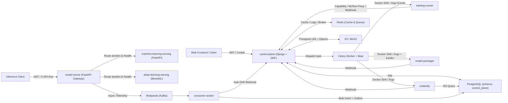
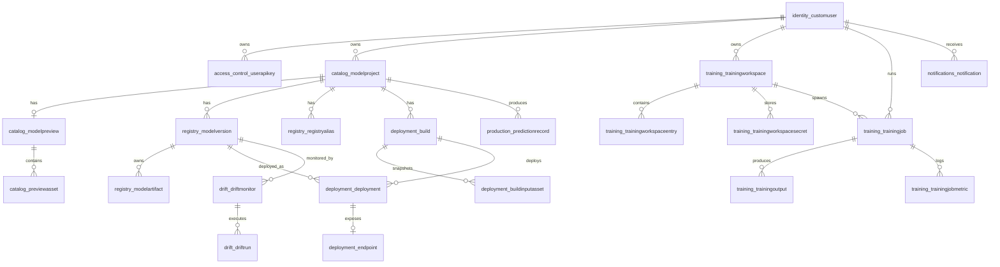

# Tổng Hợp Toàn Bộ Luồng, Endpoint và Bảng DB (Backend)

Tài liệu này tổng hợp đầy đủ kiến trúc Backend hiện tại của **MLOps PaaS** (trích xuất trực tiếp từ source code trong [`services/`](file:///d:/AI%20Models/mlops-paas-system/services)), gồm:
- **9 service backend** (4 service có HTTP API, 4 worker/runner chạy nền/ephemeral, 1 công cụ load-test).
- **11 luồng nghiệp vụ end-to-end** (kèm các tác vụ Celery & lịch chạy Celery Beat).
- **151 HTTP endpoints** (141 endpoints của `control-plane`, 5 của `model-server`, 3 của `machine-learning-serving`, 2 của `deep-learning-serving`).
- **46 bảng DB nghiệp vụ (domain)** + **7 bảng framework/JWT** + **3 bảng trung gian M2M** trên PostgreSQL schema `control_plane`.

---

## 1. Kiến trúc tổng quan các Backend Services

| Service | Thư mục | Công nghệ | Vai trò | HTTP API |
| --- | --- | --- | --- | --- |
| **control-plane** | [`services/control-plane`](file:///d:/AI%20Models/mlops-paas-system/services/control-plane) | Django 5 + DRF + Celery | Modular monolith điều phối toàn bộ vòng đời, auth, metadata DB, presigned S3, dispatch & webhook | 141 endpoints (+ `/admin/`) |
| **model-server** | [`services/model-server`](file:///d:/AI%20Models/mlops-paas-system/services/model-server) | FastAPI + Uvicorn | Inference Gateway tập trung: xác thực JWT/API Key, định tuyến tới worker, gửi telemetry Kafka | 5 endpoints |
| **machine-learning-serving** | [`services/machine-learning-serving`](file:///d:/AI%20Models/mlops-paas-system/services/machine-learning-serving) | FastAPI + MLflow PyFunc | Worker chạy inference cho mô hình tabular (Scikit-Learn, XGBoost, LightGBM, CatBoost) | 3 endpoints |
| **deep-learning-serving** | [`services/deep-learning-serving`](file:///d:/AI%20Models/mlops-paas-system/services/deep-learning-serving) | BentoML + MLflow PyFunc | Worker chạy inference cho mô hình DL (PyTorch, TensorFlow, Keras, HuggingFace) | 2 endpoints |
| **training-runner** | [`services/training-runner`](file:///d:/AI%20Models/mlops-paas-system/services/training-runner) | Python Sandbox Runner | Thực thi mã huấn luyện untrusted, stream metrics/logs, nén `model.tar.gz`, gửi webhook | Không |
| **model-packager** | [`services/model-packager`](file:///d:/AI%20Models/mlops-paas-system/services/model-packager) | Python + Docker / Kaniko | Chuẩn hóa model về MLflow PyFunc, sinh Dockerfile, build & push image lên Harbor | Không |
| **evidently** | [`services/evidently`](file:///d:/AI%20Models/mlops-paas-system/services/evidently) | Python + Evidently AI | So sánh dữ liệu reference (S3) vs production (PG RO), xuất báo cáo HTML/JSON, gửi webhook | Không |
| **consumer** | [`services/consumer`](file:///d:/AI%20Models/mlops-paas-system/services/consumer) | Python + confluent-kafka | Đọc Kafka micro-batch → bulk insert PG + outbox auto-drift + DLQ khi lỗi | Không |
| **predict-tester** | [`services/predict-tester`](file:///d:/AI%20Models/mlops-paas-system/services/predict-tester) | Locust + Python CLI | Công cụ kiểm thử tải cho `model-server` (không phải runtime production) | Không |

---

## 2. Toàn bộ các luồng nghiệp vụ Backend (11 luồng chính)

### Luồng 1: Xác thực, OAuth2, OTP & Vòng đời tài khoản (`apps.auth`, `apps.access`)
1. **Đăng ký / Đặt lại mật khẩu / Đổi mật khẩu qua OTP**:
   - `request-otp` → tạo & lưu OTP vào Redis, gửi email SMTP → `verify-otp` cấp verification token → `complete` tạo `CustomUser` hoặc cập nhật password (tăng `session_version`).
2. **Đăng nhập & Rotate Refresh Token**:
   - Đăng nhập mật khẩu (`/api/auth/token/`) hoặc OAuth2 Google/GitHub (`/api/auth/oauth/{google|github}/`): kiểm tra header `Origin` + `X-Requested-With: XMLHttpRequest`, trả về RS256 Access JWT (15 phút) trong JSON và đặt Refresh Token (7 ngày) trong `HttpOnly` cookie.
   - `/api/auth/token/refresh/`: khóa bản ghi user, xác thực trạng thái active/chưa soft-delete, **atomic blacklist** token cũ rồi cấp cặp access/refresh mới.
   - `/api/auth/logout/`: blacklist refresh token trong DB trước khi xóa cookie.
   - `/api/auth/.well-known/jwks.json`: phát public key RS256 cho `model-server` xác thực stateless.
3. **Quản lý Profile & Avatar**:
   - `PUT /api/auth/profile/` validate ảnh (≤ 5 MiB), upload key UUID mới lên S3 ngoài transaction, đổi `CustomUser.avatar` trong transaction và enqueue Celery `delete_avatar_object` xóa ảnh cũ sau commit.
4. **Xóa tài khoản 2 giai đoạn (Soft-delete → Retention Purge)**:
   - `DELETE /api/auth/profile/delete/`: đặt `is_active=False`, `deleted_at=now()`, tăng `session_version`, blacklist toàn bộ refresh token, ghi `EventOutbox` (`tenant.disabled`), và enqueue `stop_user_active_executions` để dừng ngay các `Deployment` đang chạy + hủy `Build`, `TrainingJob`, `DriftRun` đang hoạt động.
   - Định kỳ theo `ACCOUNT_DELETION_PURGE_INTERVAL_SECONDS` (mặc định 3600s), Celery Beat gọi `purge_expired_deleted_accounts`: sau `ACCOUNT_DELETION_RETENTION_DAYS` (mặc định 30 ngày), xóa cứng lần lượt `ModelProject` → `TrainingJob` → `TrainingWorkspace` → prefix S3 (`users/{tenant_id}/`, `staging/users/{tenant_id}/`) → xóa dòng `CustomUser`.
5. **Project API Keys (`apps.access`)**:
   - Tạo/đổi tên/thu hồi/tạo lại `UserAPIKey` (lưu SHA-256 hash + prefix, phạm vi `allowed_projects`) dùng cho client M2M gọi `model-server`.

### Luồng 2: Quản lý Model Project & Model Preview (`apps.catalog`)
1. **Tạo dự án & Upload Staging**:
   - Client xin presigned PUT URLs qua `POST /api/models/preview/upload-urls/` (upload vào `staging/users/{tenant_id}/...`) → gọi `POST /api/models/` tạo `ModelProject` + `ModelPreview` + `PreviewAsset` (copy staging sang `preview/committed/`).
   - Có nhánh `POST /api/models/training-projects/` cho phép tạo project trống từ luồng assign Training Job.
2. **Chỉnh sửa Preview**:
   - `PATCH /api/models/<project_id>/preview/` cập nhật flavor, format, `requirements_text`, thay/xóa asset và tăng `revision` (optimistic concurrency).
   - Cung cấp xem trước thuộc tính (`preview/attributes/`), dữ liệu reference (`preview/reference-preview/`), và snapshot của deployment đang chạy (`running-source/`, `running-attributes/`, `label-mapping/`).
3. **Xóa Project bất đồng bộ (Retryable Hard Delete)**:
   - `DELETE /api/models/<project_id>/` đánh dấu `deletion_state=deleting`, enqueue `execute_project_deletion` dừng runtime/hủy job → (nếu Argo) đợi callback `POST /internal/webhooks/project-deletions/<project_id>/` rồi chạy `complete_project_deletion` xóa ảnh Harbor, S3 và dòng DB. Celery Beat `reconcile_stalled_deletions` tự phục hồi nếu task bị treo.

### Luồng 3: Training Workspace & Thực thi Training Job (`apps.training`, `training-runner`)
1. **Soạn thảo Draft trên Workspace (độc lập với Project)**:
   - User tạo/sửa `TrainingWorkspace` (entry point, env, flavor, CPU/RAM/GPU profile, timeout), quản lý cây file/folder (`TrainingWorkspaceEntry` lưu S3), và biến bí mật mã hóa (`TrainingWorkspaceSecret`).
2. **Submit & Chuẩn bị Input (Immutable Snapshot)**:
   - `POST /api/training-workspaces/<workspace_id>/runs/` khóa workspace, tạo `TrainingJob` ở trạng thái `pending` (1 workspace chỉ có tối đa 1 active job), enqueue `prepare_training_input`.
   - `prepare_training_input` nén toàn bộ entries workspace vào `code/source.zip`, cấp quota reservation (`LocalTrainingReservation` hoặc `TrainingQuotaReservation` + `TrainingQuotaWeek`) và capability tokens (`TrainingJobCapability`), sau đó dispatch qua Docker SDK hoặc Argo Events (Kubeflow Trainer v2 `TrainJob`).
3. **Thực thi trên `training-runner`**:
   - Runner chỉ nhận `TRAINING_JOB_ID` và Capability Token (không có AWS/DB creds).
   - Gọi Control Plane lấy `input-download-urls` & `runtime-config` (one-use), cài `requirements.txt`, chạy `entry_point` trong process group riêng (`os.killpg` khi cancel).
   - Ghi metrics/params/tags qua MLflow Proxy API (`/api/2.0/mlflow/...`), stream log ra Redis (`training_logs:{job_id}`) hoặc Loki.
   - Đóng gói output thành `model.tar.gz` (`model/`, `metadata/`, `_mlops/`), xin `output-upload-url` để PUT lên S3, gửi callback về `/internal/webhooks/training-jobs/<job_id>/`.
4. **Hoàn tất Output & Gán Project**:
   - Control Plane chạy `finalize_output`: giải nén/xác minh an toàn, tách lưu `TrainingOutput` (model, metadata, reference CSV, insights), xóa file `model.tar.gz` tạm, trả quota reservation, chuyển job sang `completed`.
   - User có thể chọn file model output (`PATCH .../model-output/`), gán job vào một Project (`POST .../project/`), hoặc kích hoạt Build trực tiếp từ job (`POST .../build/`).

### Luồng 4: MLflow Tracking & Artifact Proxy (`apps.mlflow`)
- Control Plane giả lập bộ REST API chuẩn MLflow 2.0 (`/api/2.0/mlflow/...` và `/mlflow-artifacts/...`) được xác thực bằng capability/token của `TrainingJob`.
- Ánh xạ trực tiếp experiment/run/metric/param/tag vào `TrainingJob`, `TrainingJobMetric`, `TrainingJobParam`, `TrainingJobTag` (không tạo thêm bảng DB riêng) và proxy upload/download artifact sang S3 (giới hạn 5 GiB).

### Luồng 5: Đóng gói & Build OCI Image (`apps.deployment`, `model-packager`)
1. **Khởi tạo Build**:
   - Từ Project Preview (`POST /api/models/<project_id>/builds/`) hoặc Training Job (`POST /api/training-jobs/<job_id>/build/`) hoặc Re-build (`POST /api/builds/<build_id>/rebuild/`).
   - Snapshot các file đầu vào vào `BuildInputAsset` (S3 `builds/{build_id}/inputs/`), enqueue `execute_build`.
2. **Thực thi `model-packager`**:
   - Chuẩn hóa model (`.pkl`, `.joblib`, `.xgb`, `.pt`, `.pth`, `.h5`, `.keras`) thành MLflow PyFunc (`MLmodel`), chọn base image (`machine-learning-serving` cho ML cổ điển, `deep-learning-serving` cho DL), build image (Docker local hoặc Argo + Kaniko) và push lên Harbor (`image_uri`, `image_digest`).
   - Gửi kết quả về `POST /internal/webhooks/builds/<build_id>/`.
3. **Hủy / Xóa Build**:
   - `POST /api/builds/<build_id>/cancel/` dừng container/Argo workflow; `DELETE /api/builds/<build_id>/` xóa ảnh chưa đăng ký và dọn S3 (qua task `delete_build`).

### Luồng 6: Đăng ký Model Version & Registry (`apps.registry`)
1. **Đăng ký phiên bản bất biến (`POST /api/builds/<build_id>/register/`)**:
   - Task `register_build` / `register_version` copy artifact sang tầng bất biến `versions/{version_id}/artifacts/`, tạo `ModelVersion`, `ModelArtifact`, `ModelMetric` (kèm metrics/params/insights summary).
   - **Tối ưu S3 (vừa triển khai)**: ngay sau khi commit version thành công, tự động xóa prefix `builds/{build_id}/` trên S3, đặt `BuildInputAsset.s3_uri=""`, `purged_at=now()`, `build.package_uri=""` để tránh lưu trùng artifact giữa Build và Version.
2. **Supplemental Artifacts, Alias & Smoke Test**:
   - Bổ sung artifact phụ (`POST /api/registry/versions/<version_id>/supplemental-artifacts/`).
   - Gắn alias động (`champion`, `challenger`...) qua `POST /api/registry/models/<project_id>/aliases/` và gọi dự đoán theo alias qua `POST /api/registry/models/<project_id>/aliases/<alias_name>/predict/`.
   - Chạy kiểm thử nhanh `POST /api/registry/versions/<version_id>/smoke-test/`.

### Luồng 7: Triển khai (Deployment), Readiness & Health Monitoring (`apps.deployment`)
1. **Deploy phiên bản đã đăng ký (`POST /api/deployments/`)**:
   - Tạo `Deployment` + `Endpoint`, enqueue `execute_deployment` khởi chạy container Docker hoặc Kubernetes Deployment/Service qua Argo.
   - Đợi container sẵn sàng (gọi `/health` đến khi `model_loaded=true`) và nhận callback `POST /internal/webhooks/deployments/<deployment_id>/` (bảo vệ bởi deployment capability token). Nếu quá hạn không nhận callback (Argo), task `mark_deployment_unconfirmed` chuyển sang `unconfirmed`.
   - Khi thành công: cập nhật `ModelProject.active_deployment` (nếu deploy mới lỗi, giữ nguyên bản Running cũ).
2. **Giám sát sức khỏe & Dừng Deployment**:
   - Celery Beat `scan_runtime_health` (15s/lần trên queue `runtime-health`) gọi `probe_runtime_health` kiểm tra `Endpoint.health_status`.
   - `POST /api/deployments/<deployment_id>/stop/` đánh dấu dừng và enqueue `stop_deployment`; Celery Beat `reconcile_stopped_deployments` (120s/lần) đảm bảo runtime thực sự được gỡ bỏ.

### Luồng 8: Inference Gateway & Thu thập Production Telemetry (`model-server`, `serving`, `consumer`)
1. **Xác thực & Định tuyến tại `model-server`**:
   - Client gửi `POST /models/{version_id}/predict` (hoặc `GET /models/{version_id}/health`).
   - Kiểm tra `access_mode` (`public` / `protected` / `private`): xác thực Bearer RS256 JWT (dùng JWKS cache) hoặc `X-API-Key` (SHA-256 hash cache Redis / PG).
   - Định tuyến tới worker tương ứng (`machine-learning-serving` qua `GET /health`, `POST /predict`; hoặc `deep-learning-serving` BentoML qua `POST /health`, `POST /predict`).
   - Trả kết quả ngay cho client, đồng thời ghi Prometheus metrics (`paas_predictions_total`, `paas_prediction_latency_seconds`), cập nhật bộ đếm local Redis (nếu bật) và đẩy event vào Kafka topic `mlops_paas_production_data` trong `BackgroundTasks`.
2. **Ingestion bởi `consumer`**:
   - Đọc micro-batch từ Kafka, bulk-insert vào `production_predictionrecord` (`ON CONFLICT DO NOTHING`) và đồng thời ghi tín hiệu vào `observability_eventoutbox` trong cùng 1 transaction PostgreSQL rồi mới commit Kafka offset.
   - Background thread `automatic-drift-outbox` lease các outbox event và POST về `/internal/webhooks/automatic-drift/`. Bản ghi lỗi sau max retries được đưa vào DLQ (`<topic>.dlq`).

### Luồng 9: Giám sát Drift (`apps.drift`, `evidently`)
1. **Cấu hình Monitor**: CRUD `DriftMonitor` gắn với `ModelVersion` (dữ liệu reference từ CSV upload hoặc tái sử dụng `ModelArtifact` của version, đặt `trigger_threshold` cho auto-drift).
2. **Kích hoạt Drift Run**:
   - Thủ công (`POST /api/drift-monitors/<monitor_id>/runs/`) hoặc tự động từ Consumer (`POST /internal/webhooks/automatic-drift/` khi số prediction mới đạt ngưỡng).
   - Worker `evidently` đọc reference CSV từ S3 và tối đa `MAX_SAMPLES` bản ghi từ PostgreSQL RO (`production_predictionrecord`), chạy `DataDriftPreset()`, upload `report.html`, `report.json`, `summary.json` lên S3 qua presigned PUT URLs, và gửi callback về `POST /internal/webhooks/drift-runs/<run_id>/`.
   - User xem báo cáo qua `report-url` / `report-data` và logs qua `runs/<run_id>/logs/`.

### Luồng 10: Continuous Training (`apps.ct`)
- Đã xây dựng đầy đủ **13 bảng DB** mô hình hóa vòng lặp Continuous Training có kiểm soát ngân sách nhãn (Label Budget & Ledger), cửa sổ bằng chứng (`EvidenceWindow` / `EvidenceWindowSample`), yêu cầu gán nhãn (`LabelRequest` / `LabelRequestItem` / `Feedback`), quyết định bảo trì (`MaintenancePolicy` / `MaintenanceDecision`), thực thi retraining (`MaintenanceRun` / `MaintenanceStepAttempt`), và cổng đánh giá (`EvaluationGate` so sánh Candidate vs Champion trên `DatasetSnapshot`).
- *Lưu ý hiện trạng:* `apps.ct` hiện có tầng **models + migrations + model tests**; **chưa mount REST API endpoints** vào [`config/urls.py`](file:///d:/AI%20Models/mlops-paas-system/services/control-plane/src/config/urls.py).

### Luồng 11: Observability, Outbox, Execution Reconciliation & Notifications (`apps.observability`, `apps.notifications`)
1. **Execution Watch & Reconciliation**:
   - Khi bật `TRAINING_EXECUTION_WATCH_ENABLED` / `DRIFT_EXECUTION_WATCH_ENABLED`, Beat chạy `scan_job_executions` (15s/lần) gọi `reconcile_job_execution` (và nhận observation/stop callbacks tại `/internal/executions/<kind>/<public_id>/{observations|stops}/`) để đồng bộ trạng thái bền vững, chống treo job.
   - Local Docker mode có thêm `scan_local_executions` (5s/lần) khi `LOCAL_DEPLOYMENT_WATCH_ENABLED=true`.
2. **Event Outbox → Redpanda**:
   - `publish_outbox` đọc `observability_eventoutbox` (`delivery_kind="kafka"`) và phát sự kiện ra Redpanda.
3. **Runtime Metrics & Logs Proxy**:
   - Proxy logs từ Redis (local) hoặc Grafana Loki (production với signed cursor).
   - Runtime metrics của project từ Docker SDK + Redis counter (local) hoặc Prometheus (production).
4. **Thông báo (`apps.notifications`)**:
   - Nhận alert nội bộ qua `POST /internal/webhooks/alerts/` và lưu bảng `notifications_notification`; người dùng đọc, đếm chưa đọc, đánh dấu đã đọc, xóa qua `/api/notifications/...`.

---

## 3. Danh sách toàn bộ HTTP Endpoints (151 Endpoints)

### 3.1. Control Plane — Public & User APIs

#### A. Auth & Identity (`/api/auth/`) — 17 endpoints
| Method | Path | Auth / Permission | Chức năng |
| --- | --- | --- | --- |
| `POST` | `/api/auth/token/` | Public (+ Origin/XHR check) | Đăng nhập email/password, trả Access JWT & set HttpOnly refresh cookie |
| `POST` | `/api/auth/token/refresh/` | `AllowAny` (Refresh cookie) | Rotate refresh token & cấp Access JWT mới |
| `POST` | `/api/auth/logout/` | `AllowAny` (Refresh cookie) | Blacklist refresh token & xóa cookie |
| `GET` | `/api/auth/.well-known/jwks.json` | `AllowAny` | Public JWKS (RS256) cho `model-server` |
| `POST` | `/api/auth/oauth/google/` | `AllowAny` | Đăng nhập / đăng ký qua Google OAuth2 |
| `POST` | `/api/auth/oauth/github/` | `AllowAny` | Đăng nhập / đăng ký qua GitHub OAuth2 (verify email) |
| `POST` | `/api/auth/register/request-otp/` | `AllowAny` (Throttled) | Gửi OTP đăng ký tài khoản |
| `POST` | `/api/auth/register/verify-otp/` | `AllowAny` (Throttled) | Xác minh OTP đăng ký |
| `POST` | `/api/auth/register/complete/` | `AllowAny` (Throttled) | Hoàn tất đăng ký & cấp token |
| `POST` | `/api/auth/password-reset/request-otp/` | `AllowAny` (Throttled) | Gửi OTP quên mật khẩu |
| `POST` | `/api/auth/password-reset/verify-otp/` | `AllowAny` (Throttled) | Xác minh OTP quên mật khẩu |
| `POST` | `/api/auth/password-reset/complete/` | `AllowAny` (Throttled) | Đặt lại mật khẩu mới |
| `GET`, `PUT` | `/api/auth/profile/` | `JWT` (`IsAuthenticated`) | Xem / cập nhật hồ sơ & avatar người dùng |
| `DELETE` | `/api/auth/profile/delete/` | `JWT` (`IsAuthenticated`) | Soft-delete tài khoản, dừng runtime & hẹn purge sau retention |
| `POST` | `/api/auth/profile/password-otp/` | `JWT` (`IsAuthenticated`) | Gửi OTP đổi mật khẩu |
| `POST` | `/api/auth/profile/password-otp/verify/` | `JWT` (`IsAuthenticated`) | Xác minh OTP đổi mật khẩu |
| `POST` | `/api/auth/profile/change-password/` | `JWT` (`IsAuthenticated`) | Hoàn tất đổi mật khẩu |

#### B. API Keys (`/api/api-keys/`) — 3 endpoints
| Method | Path | Auth / Permission | Chức năng |
| --- | --- | --- | --- |
| `GET`, `POST` | `/api/api-keys/` | `JWT` (`IsAuthenticated`) | Liệt kê / tạo mới Project API Key |
| `GET`, `PUT`, `PATCH`, `DELETE` | `/api/api-keys/<uuid:key_id>/` | `JWT` (`IsAuthenticated`) | Xem / sửa phạm vi project / thu hồi API Key |
| `POST` | `/api/api-keys/<uuid:key_id>/regenerate/` | `JWT` (`IsAuthenticated`) | Tạo lại secret mới cho API Key |

#### C. Catalog & Model Preview (`/api/models/`) — 13 endpoints
| Method | Path | Auth / Permission | Chức năng |
| --- | --- | --- | --- |
| `GET`, `POST` | `/api/models/` | `JWT` (`IsAuthenticated`) | Liệt kê / tạo `ModelProject` kèm preview |
| `POST` | `/api/models/training-projects/` | `JWT` (`IsAuthenticated`) | Tạo project trống dùng cho gán từ Training Job |
| `POST` | `/api/models/preview/upload-urls/` | `JWT` (`IsAuthenticated`) | Cấp presigned PUT URLs để upload staging khi tạo project |
| `GET`, `PUT`, `PATCH`, `DELETE` | `/api/models/<uuid:project_id>/` | `JWT` (`IsAuthenticated`) | Chi tiết / cập nhật / yêu cầu xóa cứng bất đồng bộ project |
| `GET`, `PATCH` | `/api/models/<uuid:project_id>/preview/` | `JWT` (`IsAuthenticated`) | Xem / cập nhật `ModelPreview` & `PreviewAsset` |
| `GET` | `/api/models/<uuid:project_id>/preview/attributes/` | `JWT` (`IsAuthenticated`) | Đọc input schema/attributes từ model preview |
| `POST` | `/api/models/<uuid:project_id>/preview/upload-urls/` | `JWT` (`IsAuthenticated`) | Cấp presigned PUT URLs cập nhật asset của preview |
| `GET` | `/api/models/<uuid:project_id>/preview/reference-preview/` | `JWT` (`IsAuthenticated`) | Xem trước mẫu dữ liệu reference CSV của preview |
| `GET` | `/api/models/<uuid:project_id>/running-source/` | `JWT` (`IsAuthenticated`) | Xem thông tin nguồn/version đang Running của project |
| `GET` | `/api/models/<uuid:project_id>/running-attributes/` | `JWT` (`IsAuthenticated`) | Xem schema input của bản đang Running |
| `GET` | `/api/models/<uuid:project_id>/label-mapping/` | `JWT` (`IsAuthenticated`) | Xem ánh xạ nhãn (label mapping) của bản đang Running |
| `GET`, `POST` | `/api/models/<uuid:project_id>/builds/` | `JWT` (`IsAuthenticated`) | Liệt kê / tạo mới Build từ Preview của project |
| `GET` | `/api/models/<uuid:project_id>/production-data/` | `JWT` (`IsAuthenticated`) | Truy vấn dữ liệu `PredictionRecord` production của project |

#### D. Model Registry (`/api/registry/`) — 7 endpoints
| Method | Path | Auth / Permission | Chức năng |
| --- | --- | --- | --- |
| `GET` | `/api/registry/models/<uuid:project_id>/versions/` | `JWT` (`IsAuthenticated`) | Liệt kê các `ModelVersion` của project |
| `GET`, `DELETE` | `/api/registry/versions/<uuid:version_id>/` | `JWT` (`IsAuthenticated`) | Xem chi tiết / xóa `ModelVersion` |
| `POST` | `/api/registry/versions/<uuid:version_id>/supplemental-artifacts/` | `JWT` (`IsAuthenticated`) | Bổ sung supplemental artifact (VD: reference CSV) cho version |
| `GET` | `/api/registry/versions/<uuid:version_id>/reference-preview/` | `JWT` (`IsAuthenticated`) | Xem trước dữ liệu reference của version |
| `POST` | `/api/registry/versions/<uuid:version_id>/smoke-test/` | `JWT` (`IsAuthenticated`) | Chạy smoke-test dự đoán nhanh cho version |
| `GET`, `POST` | `/api/registry/models/<uuid:project_id>/aliases/` | `JWT` (`IsAuthenticated`) | Liệt kê / gán alias (`champion`, `challenger`...) |
| `POST` | `/api/registry/models/<uuid:project_id>/aliases/<str:alias_name>/predict/` | `JWT` (`IsAuthenticated`) | Proxy dự đoán tới deployment của version mang alias |

#### E. Training Workspaces (`/api/training-workspaces/`) — 9 endpoints
| Method | Path | Auth / Permission | Chức năng |
| --- | --- | --- | --- |
| `GET`, `POST` | `/api/training-workspaces/` | `JWT` (`IsAuthenticated`) | Liệt kê / tạo `TrainingWorkspace` |
| `GET`, `PATCH`, `DELETE` | `/api/training-workspaces/<uuid:workspace_id>/` | `JWT` (`IsAuthenticated`) | Xem / cập nhật cấu hình / xóa workspace |
| `POST` | `/api/training-workspaces/<uuid:workspace_id>/runs/` | `JWT` (`IsAuthenticated`) | Submit workspace revision thành `TrainingJob` mới |
| `GET` | `/api/training-workspaces/<uuid:workspace_id>/jobs/` | `JWT` (`IsAuthenticated`) | Liệt kê các job thuộc workspace |
| `GET` | `/api/training-workspaces/<uuid:workspace_id>/jobs/<uuid:job_id>/` | `JWT` (`IsAuthenticated`) | Chi tiết 1 job trong workspace |
| `POST` | `/api/training-workspaces/<uuid:workspace_id>/entries/` | `JWT` (`IsAuthenticated`) | Tạo/upload file hoặc thư mục (`TrainingWorkspaceEntry`) |
| `PATCH`, `DELETE` | `/api/training-workspaces/<uuid:workspace_id>/entries/<uuid:entry_id>/` | `JWT` (`IsAuthenticated`) | Sửa/đổi tên/xóa file hoặc thư mục trong workspace |
| `PUT`, `DELETE` | `/api/training-workspaces/<uuid:workspace_id>/secrets/<str:name>/` | `JWT` (`IsAuthenticated`) | Tạo/cập nhật/xóa secret mã hóa của workspace |
| `GET` | `/api/training-workspaces/<uuid:workspace_id>/input/download/` | `JWT` (`IsAuthenticated`) | Tải toàn bộ input của workspace dưới dạng zip |

#### F. Training Jobs (`/api/training-jobs/`) — 19 endpoints
| Method | Path | Auth / Permission | Chức năng |
| --- | --- | --- | --- |
| `GET` | `/api/training-jobs/` | `JWT` (`IsAuthenticated`) | Liệt kê tất cả `TrainingJob` của user |
| `GET` | `/api/training-jobs/compare/` | `JWT` (`IsAuthenticated`) | So sánh metrics/params giữa nhiều training jobs |
| `GET` | `/api/training-jobs/usage/` | `JWT` (`IsAuthenticated`) | Xem mức sử dụng quota CPU/GPU hàng tuần |
| `GET` | `/api/training-jobs/runtime-capabilities/` | `JWT` (`IsAuthenticated`) | Xem profile CPU/RAM/GPU khả dụng & giới hạn timeout |
| `GET`, `DELETE` | `/api/training-jobs/<uuid:job_id>/` | `JWT` (`IsAuthenticated`) | Chi tiết / xóa `TrainingJob` |
| `GET` | `/api/training-jobs/<uuid:job_id>/experiment-metrics/` | `JWT` (`IsAuthenticated`) | Lấy lịch sử experiment metrics/params/tags của job |
| `GET` | `/api/training-jobs/<uuid:job_id>/runtime-metrics/` | `JWT` (`IsAuthenticated`) | Lấy runtime resource metrics (CPU/RAM/GPU) của job |
| `POST` | `/api/training-jobs/<uuid:job_id>/project/` | `JWT` (`IsAuthenticated`) | Gán (hoặc đổi) `ModelProject` cho job |
| `POST` | `/api/training-jobs/<uuid:job_id>/cancel/` | `JWT` (`IsAuthenticated`) | Hủy job đang chờ/đang chạy |
| `GET` | `/api/training-jobs/<uuid:job_id>/events/` | `JWT` (`IsAuthenticated`) | Xem dòng sự kiện vòng đời (`LifecycleEvent`) của job |
| `GET` | `/api/training-jobs/<uuid:job_id>/logs/` | `JWT` (`IsAuthenticated`) | Đọc logs real-time/lịch sử của job (cursor-based) |
| `GET` | `/api/training-jobs/<uuid:job_id>/input/` | `JWT` (`IsAuthenticated`) | Xem danh sách snapshot input của job |
| `GET` | `/api/training-jobs/<uuid:job_id>/input/download/` | `JWT` (`IsAuthenticated`) | Tải gói input snapshot của job |
| `GET` | `/api/training-jobs/<uuid:job_id>/outputs/download/` | `JWT` (`IsAuthenticated`) | Tải toàn bộ output của job |
| `GET` | `/api/training-jobs/<uuid:job_id>/outputs/<uuid:output_id>/download/` | `JWT` (`IsAuthenticated`) | Tải 1 file `TrainingOutput` cụ thể |
| `DELETE` | `/api/training-jobs/<uuid:job_id>/outputs/` | `JWT` (`IsAuthenticated`) | Dọn xóa output artifacts của job trên S3 |
| `GET`, `PATCH` | `/api/training-jobs/<uuid:job_id>/model-output/` | `JWT` (`IsAuthenticated`) | Xem / chọn artifact output dùng để build model |
| `GET` | `/api/training-jobs/<uuid:job_id>/reference-preview/` | `JWT` (`IsAuthenticated`) | Xem trước dữ liệu reference trong output của job |
| `POST` | `/api/training-jobs/<uuid:job_id>/build/` | `JWT` (`IsAuthenticated`) | Tạo `Build` trực tiếp từ output của training job |

#### G. Builds, Deployments & Endpoints (`/api/builds/`, `/api/deployments/`, `/api/endpoints/`) — 13 endpoints
| Method | Path | Auth / Permission | Chức năng |
| --- | --- | --- | --- |
| `GET` | `/api/builds/` | `JWT` (`IsAuthenticated`) | Liệt kê danh sách `Build` |
| `GET`, `DELETE` | `/api/builds/<uuid:build_id>/` | `JWT` (`IsAuthenticated`) | Chi tiết / xóa `Build` (kèm dọn ảnh/S3 nếu chưa register) |
| `POST` | `/api/builds/<uuid:build_id>/cancel/` | `JWT` (`IsAuthenticated`) | Hủy build đang chạy |
| `GET` | `/api/builds/<uuid:build_id>/logs/` | `JWT` (`IsAuthenticated`) | Đọc logs quá trình build |
| `POST` | `/api/builds/<uuid:build_id>/register/` | `JWT` (`IsAuthenticated`) | Đăng ký Build thành `ModelVersion` bất biến |
| `POST` | `/api/builds/<uuid:build_id>/rebuild/` | `JWT` (`IsAuthenticated`) | Tạo attempt Build mới từ Preview hoặc source job gốc |
| `GET`, `POST` | `/api/deployments/` | `JWT` (`IsAuthenticated`) | Liệt kê / khởi tạo `Deployment` từ `ModelVersion` |
| `GET` | `/api/deployments/<uuid:deployment_id>/` | `JWT` (`IsAuthenticated`) | Chi tiết `Deployment` & `Endpoint` |
| `GET` | `/api/deployments/<uuid:deployment_id>/logs/` | `JWT` (`IsAuthenticated`) | Logs quá trình triển khai (deploy pipeline) |
| `GET` | `/api/deployments/<uuid:deployment_id>/runtime-logs/` | `JWT` (`IsAuthenticated`) | Logs runtime của container/pod đang phục vụ |
| `POST` | `/api/deployments/<uuid:deployment_id>/stop/` | `JWT` (`IsAuthenticated`) | Dừng `Deployment` & gỡ runtime |
| `GET` | `/api/endpoints/` | `JWT` (`IsAuthenticated`) | Liệt kê các serving `Endpoint` |
| `GET` | `/api/endpoints/<uuid:endpoint_id>/logs/` | `JWT` (`IsAuthenticated`) | Logs của endpoint đang chạy |

#### H. Drift Monitors & Drift Runs (`/api/drift-monitors/`) — 11 endpoints
| Method | Path | Auth / Permission | Chức năng |
| --- | --- | --- | --- |
| `GET`, `POST` | `/api/drift-monitors/` | `JWT` (`IsAuthenticated`) | Liệt kê / tạo mới `DriftMonitor` |
| `GET`, `PUT`, `PATCH`, `DELETE` | `/api/drift-monitors/<uuid:monitor_id>/` | `JWT` (`IsAuthenticated`) | Chi tiết / cập nhật / xóa `DriftMonitor` |
| `POST` | `/api/drift-monitors/<uuid:monitor_id>/cancel/` | `JWT` (`IsAuthenticated`) | Hủy các drift run đang chạy thuộc monitor |
| `GET` | `/api/drift-monitors/<uuid:monitor_id>/reference-url/` | `JWT` (`IsAuthenticated`) | Lấy presigned GET URL của file reference CSV |
| `GET` | `/api/drift-monitors/<uuid:monitor_id>/reference-preview/` | `JWT` (`IsAuthenticated`) | Xem trước mẫu dữ liệu reference CSV |
| `POST` | `/api/drift-monitors/<uuid:monitor_id>/runs/` | `JWT` (`IsAuthenticated`) | Kích hoạt thủ công 1 `DriftRun` |
| `DELETE` | `/api/drift-monitors/runs/<uuid:run_id>/` | `JWT` (`IsAuthenticated`) | Xóa 1 `DriftRun` |
| `POST` | `/api/drift-monitors/runs/<uuid:run_id>/cancel/` | `JWT` (`IsAuthenticated`) | Hủy 1 `DriftRun` đang chạy |
| `GET` | `/api/drift-monitors/runs/<uuid:run_id>/logs/` | `JWT` (`IsAuthenticated`) | Đọc logs thực thi của `DriftRun` |
| `GET` | `/api/drift-monitors/runs/<uuid:run_id>/report-url/` | `JWT` (`IsAuthenticated`) | Lấy presigned URL của báo cáo Evidently HTML |
| `GET` | `/api/drift-monitors/runs/<uuid:run_id>/report-data/` | `JWT` (`IsAuthenticated`) | Lấy dữ liệu JSON/summary phân tích drift |

#### I. Observability & Health (`/api/observability/`, `/health/`) — 5 endpoints
| Method | Path | Auth / Permission | Chức năng |
| --- | --- | --- | --- |
| `GET` | `/api/observability/models/<uuid:project_id>/` | `JWT` (`IsAuthenticated`) | Tổng quan observability của project (events, deployments, drift, prediction stats) |
| `GET` | `/api/observability/models/<uuid:project_id>/runtime-metrics/` | `JWT` (`IsAuthenticated`) | Metrics CPU/RAM/RPS của deployment đang Running |
| `GET` | `/health/live` | `AllowAny` | Liveness probe |
| `GET` | `/health/ready` | `AllowAny` | Readiness probe (kiểm tra DB/Redis) |
| `GET` | `/health/metrics` | `AllowAny` | Prometheus metrics endpoint của Control Plane |

#### J. Notifications (`/api/notifications/`) — 5 endpoints
| Method | Path | Auth / Permission | Chức năng |
| --- | --- | --- | --- |
| `GET` | `/api/notifications/` | `JWT` (`IsAuthenticated`) | Liệt kê thông báo của user |
| `GET` | `/api/notifications/unread-count/` | `JWT` (`IsAuthenticated`) | Đếm số thông báo chưa đọc |
| `POST` | `/api/notifications/mark-all-read/` | `JWT` (`IsAuthenticated`) | Đánh dấu tất cả là đã đọc |
| `PATCH` | `/api/notifications/<uuid:public_id>/read/` | `JWT` (`IsAuthenticated`) | Đánh dấu 1 thông báo đã đọc |
| `DELETE` | `/api/notifications/<uuid:public_id>/` | `JWT` (`IsAuthenticated`) | Xóa 1 thông báo |

---

### 3.2. Control Plane — MLflow Tracking & Artifact Proxy APIs (25 route bindings)
*Xác thực bằng Training Job capability token bên trong view.*

| Method | Path | Chức năng |
| --- | --- | --- |
| `GET`, `POST` | `/api/2.0/mlflow/experiments/get-by-name` | Tìm experiment theo tên |
| `POST` | `/api/2.0/mlflow/experiments/create` | Tạo experiment |
| `GET` | `/api/2.0/mlflow/experiments/get` | Lấy thông tin experiment |
| `POST` | `/api/2.0/mlflow/runs/create` | Tạo MLflow run gắn với `TrainingJob` |
| `POST` | `/api/2.0/mlflow/runs/update` | Cập nhật trạng thái run |
| `GET` | `/api/2.0/mlflow/runs/get` | Đọc chi tiết run |
| `POST` | `/api/2.0/mlflow/runs/log-batch` | Ghi batch metrics/params/tags |
| `POST` | `/api/2.0/mlflow/runs/log-metric` | Ghi 1 metric (`TrainingJobMetric`) |
| `POST` | `/api/2.0/mlflow/runs/log-parameter` | Ghi 1 param (`TrainingJobParam`) |
| `POST` | `/api/2.0/mlflow/runs/set-tag` | Ghi 1 tag (`TrainingJobTag`) |
| `GET` | `/api/2.0/mlflow/metrics/get-history` | Đọc lịch sử metric theo step |
| `GET` | `/api/2.0/mlflow/artifacts/list` | Liệt kê artifact của run |
| `POST` | `/api/2.0/mlflow/artifacts/upload-url` | Cấp URL upload artifact |
| `GET`, `PUT`, `DELETE` | `/api/2.0/mlflow-artifacts/artifacts[/(<subpath>)]` *(và 3 alias tiền tố `/mlflow-artifacts/...`, `/api/2.0/mlflow/...` — tổng 8 route)* | Proxy upload/download/delete MLflow artifact |
| `GET`, `POST`, `PUT`, `DELETE` | `/api/2.0/mlflow-artifacts/mpu/<subpath>` *(và 3 alias tiền tố — tổng 4 route)* | Multipart upload fallback cho artifact lớn |

---

### 3.3. Control Plane — Internal Webhooks & Runner Callbacks (14 endpoints)
| Method | Path | Cơ chế xác thực | Caller | Chức năng |
| --- | --- | --- | --- | --- |
| `POST` | `/internal/webhooks/builds/<uuid:build_id>/` | `HasInternalWebhookSecret` | `model-packager` / Argo | Báo kết quả build (`image_uri`, `digest`, `package_uri`, lỗi) |
| `POST` | `/internal/webhooks/deployments/<uuid:deployment_id>/` | `HasDeploymentCallbackToken` | Deploy runner / Argo | Báo deployment sẵn sàng (`ready`) hoặc lỗi |
| `POST` | `/internal/webhooks/project-deletions/<uuid:project_id>/` | `HasInternalWebhookSecret` | Argo delete workflow | Xác nhận runtime đã dừng để hoàn tất xóa project |
| `POST` | `/internal/webhooks/training-jobs/<uuid:job_id>/` | Job Capability Token | `training-runner` / Argo | Báo trạng thái/kết quả thực thi training job |
| `POST` | `/internal/webhooks/training-jobs/<uuid:job_id>/cancellation/` | Internal secret / Token | Argo cancel workflow | Xác nhận hủy training job |
| `POST` | `/internal/training-jobs/<uuid:job_id>/output-upload-url/` | Job Capability Token | `training-runner` | Xin presigned PUT URL để upload `model.tar.gz` |
| `POST` | `/internal/training-jobs/<uuid:job_id>/input-download-urls/` | Job Capability Token | `training-runner` | Xin presigned GET URLs cho `code/source.zip` (và legacy data) |
| `POST` | `/internal/training-jobs/<uuid:job_id>/runtime-config/` | Job Capability Token (one-use) | `training-runner` | Lấy env + decrypted secrets 1 lần lúc khởi động |
| `POST` | `/internal/webhooks/drift-runs/<uuid:run_id>/` | `HasInternalWebhookSecret` | `evidently` / Argo | Báo kết quả drift (`drift_score`, `has_drift`, `summary`, URIs) |
| `GET` | `/internal/drift-runs/<uuid:run_id>/model-package-url/` | `HasInternalWebhookSecret` | `evidently` | Lấy presigned URL gói model để trích signature/schema |
| `POST` | `/internal/webhooks/automatic-drift/` | `HasInternalWebhookSecret` | `consumer` outbox dispatcher | Nhận tín hiệu đạt ngưỡng mẫu để kích hoạt auto-drift |
| `POST` | `/internal/webhooks/alerts/` | `HasInternalWebhookSecret` | Alertmanager / monitoring | Nhận cảnh báo hệ thống & tạo `Notification` |
| `POST` | `/internal/executions/<str:kind>/<uuid:public_id>/observations/` | Signed Observation Lease Token | Argo reconcile workflow | Báo trạng thái quan sát thực tế của Training/Drift/Build |
| `POST` | `/internal/executions/<str:kind>/<uuid:public_id>/stops/` | Signed Observation/Stop Token | Argo stop workflow | Xác nhận runtime đã được dừng thành công |

---

### 3.4. Inference Services Endpoints (10 Endpoints)

#### Model Server Gateway (`services/model-server/src/api.py`) — 5 endpoints
| Method | Path | Auth | Chức năng |
| --- | --- | --- | --- |
| `GET` | `/` | Public | Liveness & trạng thái kết nối Registry DB |
| `GET` | `/health/ready` | Public | Readiness check (PostgreSQL, Redis, Kafka) |
| `GET` | `/metrics` | Public (internal scrape) | Prometheus MultiProcess metrics |
| `GET` | `/models/{version_id}/health` | JWT / `X-API-Key` / Public (theo `access_mode`) | Kiểm tra trạng thái sẵn sàng của worker phục vụ version |
| `POST` | `/models/{version_id}/predict` | JWT / `X-API-Key` / Public (theo `access_mode`) | Định tuyến inference tới worker + gửi telemetry sang Redpanda |

#### Machine Learning Serving Worker (`services/machine-learning-serving/src/api.py`) — 3 endpoints
| Method | Path | Auth | Chức năng |
| --- | --- | --- | --- |
| `GET` | `/` | Internal network | Liveness cơ bản |
| `GET` | `/health` | Internal network | Báo `model_loaded`, `project_id`, `model_version_id`, engine |
| `POST` | `/predict` | Internal network | Căn chỉnh cột feature theo signature, chạy `predict()` & `predict_proba()` |

#### Deep Learning Serving Worker (`services/deep-learning-serving/src/service.py` — BentoML) — 2 endpoints
| Method | Path | Auth | Chức năng |
| --- | --- | --- | --- |
| `POST` | `/health` | Internal network | Báo trạng thái `model_loaded` của BentoML service |
| `POST` | `/predict` | Internal network | Chuẩn hóa tensor input/output & chạy `mlflow.pyfunc.predict()` |

---

## 4. Toàn bộ các bảng trong Database (PostgreSQL schema `control_plane`)

Tổng cộng có **46 bảng domain** (thuộc 11/12 Django apps — `apps.mlflow` không có bảng riêng), **7 bảng Django/SimpleJWT framework**, và **3 bảng trung gian M2M**.

### Sơ đồ quan hệ lõi (Core ERD)

### 4.1. Nhóm Identity & Access (2 bảng domain + 1 bảng M2M)
| App | Model | Tên bảng DB | Mô tả & Khóa ngoại chính |
| --- | --- | --- | --- |
| `apps.auth` (`identity`) | `CustomUser` | `identity_customuser` | Tài khoản người dùng (`public_id`, `email`, `tenant_id`, profile, `avatar`, `auth_provider`, `session_version`, `deleted_at`, `purge_started_at`, `purge_next_attempt_at`) |
| `apps.access` (`access_control`) | `UserAPIKey` | `access_control_userapikey` | API Key dạng hash SHA-256 (`user -> identity_customuser`, `key_prefix`, `key_hash`, `revoked_at`). Có bảng M2M `access_control_userapikey_allowed_projects` nối `catalog_modelproject`. |

### 4.2. Nhóm Catalog (3 bảng)
| App | Model | Tên bảng DB | Mô tả & Khóa ngoại chính |
| --- | --- | --- | --- |
| `apps.catalog` | `ModelProject` | `catalog_modelproject` | Dự án model (`owner -> identity_customuser`, `active_deployment -> deployment_deployment`, `access_mode`, `next_version_number`, trạng thái xóa `deletion_state`) |
| `apps.catalog` | `ModelPreview` | `catalog_modelpreview` | Bản nháp preview 1-1 với project (`project -> catalog_modelproject`, `flavor`, `artifact_format`, `requirements_text`, `revision`) |
| `apps.catalog` | `PreviewAsset` | `catalog_previewasset` | Tệp tài nguyên thuộc preview (`preview -> catalog_modelpreview`, `kind`, `s3_uri`, `checksum`, `size_bytes`) |

### 4.3. Nhóm Registry (4 bảng)
| App | Model | Tên bảng DB | Mô tả & Khóa ngoại chính |
| --- | --- | --- | --- |
| `apps.registry` | `ModelVersion` | `registry_modelversion` | Phiên bản model bất biến (`project -> catalog_modelproject`, `source_job -> training_trainingjob`, `version`, `stage`, `deployability`, `metrics/params/insights_summary`) |
| `apps.registry` | `ModelArtifact` | `registry_modelartifact` | Tệp artifact bất biến của version (`version -> registry_modelversion`, `kind`, `uri`, `checksum`, `metadata`) |
| `apps.registry` | `ModelMetric` | `registry_modelmetric` | Các chỉ số đánh giá gắn với version (`version -> registry_modelversion`, `name`, `value`, `step`, `dataset_role`) |
| `apps.registry` | `RegistryAlias` | `registry_registryalias` | Con trỏ alias động trên project (`project -> catalog_modelproject`, `version -> registry_modelversion`, `name`) |

### 4.4. Nhóm Training (14 bảng)
| App | Model | Tên bảng DB | Mô tả & Khóa ngoại chính |
| --- | --- | --- | --- |
| `apps.training` | `TrainingWorkspace` | `training_trainingworkspace` | Draft workspace thuộc user (`owner -> identity_customuser`, `revision`, `entry_point`, `environment`, cấu hình CPU/RAM/GPU/timeout) |
| `apps.training` | `TrainingWorkspaceEntry` | `training_trainingworkspaceentry` | File/folder trong workspace (`workspace -> training_trainingworkspace`, `relative_path`, `kind`, `s3_uri`, `checksum`) |
| `apps.training` | `TrainingWorkspaceSecret` | `training_trainingworkspacesecret` | Biến bí mật mã hóa (`workspace -> training_trainingworkspace`, `name`, `ciphertext`) |
| `apps.training` | `TrainingJob` | `training_trainingjob` | Lần chạy training bất biến (61 cột: `owner`, `workspace`, `project [NULL]`, `baseline_version [NULL]`, `dataset_snapshot [NULL]`, snapshot URI, resource profile, execution lease/deadlines, trạng thái & tracking) |
| `apps.training` | `LocalTrainingPool` | `training_localtrainingpool` | Định danh pool Docker cục bộ (`daemon_id`) phục vụ cấp phát CPU/RAM |
| `apps.training` | `LocalTrainingReservation` | `training_localtrainingreservation` | Bản ghi giữ chỗ CPU/RAM local (`pool -> training_localtrainingpool`, `job_id`, `vcpu`, `memory_mb`, `active`) |
| `apps.training` | `TrainingQuotaReservation` | `training_trainingquotareservation` | Giữ chỗ quota tài nguyên theo user/job (`owner -> identity_customuser`, `job_id`, `resource`, `max_runtime_seconds`) |
| `apps.training` | `TrainingQuotaWeek` | `training_trainingquotaweek` | Phân bổ quota theo tuần (`reservation -> training_trainingquotareservation`, `week_start`, `reserved_seconds`, `used_seconds`) |
| `apps.training` | `TrainingJobCapability` | `training_trainingjobcapability` | Token năng lực ngắn hạn cho runner (`job -> training_trainingjob`, `purpose`, `token_hash`, `expires_at`, `consumed_at`) |
| `apps.training` | `TrainingJobMetric` | `training_trainingjobmetric` | Lịch sử metric theo step từ MLflow proxy/runner (`job -> training_trainingjob`, `name`, `value`, `step`) |
| `apps.training` | `TrainingJobParam` | `training_trainingjobparam` | Tham số huấn luyện (`job -> training_trainingjob`, `name`, `value`) |
| `apps.training` | `TrainingJobTag` | `training_trainingjobtag` | Thẻ metadata của job (`job -> training_trainingjob`, `name`, `value`) |
| `apps.training` | `TrainingOutput` | `training_trainingoutput` | Các tệp kết quả đã giải nén & kiểm chứng (`job -> training_trainingjob`, `kind`, `relative_path`, `s3_uri`, `checksum`) |
| `apps.training` | `TrainingStorageCopy` | `training_trainingstoragecopy` | Theo dõi xác minh sao chép S3 idempotent (`job -> training_trainingjob`, `source_uri`, `destination_uri`, `checksum`) |

### 4.5. Nhóm Deployment & Build (4 bảng)
| App | Model | Tên bảng DB | Mô tả & Khóa ngoại chính |
| --- | --- | --- | --- |
| `apps.deployment` | `Build` | `deployment_build` | Tác vụ đóng gói OCI image (`project -> catalog_modelproject`, `source_job -> training_trainingjob [NULL]`, `version -> registry_modelversion [NULL]`, `image_uri`, `image_digest`, `registration_status`, `deletion_state`) |
| `apps.deployment` | `BuildInputAsset` | `deployment_buildinputasset` | Snapshot file đầu vào của build (`build -> deployment_build`, `kind`, `s3_uri`, `purged_at`) |
| `apps.deployment` | `Deployment` | `deployment_deployment` | Lần triển khai phục vụ 1 version (`version -> registry_modelversion`, `build -> deployment_build`, `backend`, `status`, `deployed_at`, `stopped_at`) |
| `apps.deployment` | `Endpoint` | `deployment_endpoint` | Endpoint 1-1 của Deployment (`deployment -> deployment_deployment`, `public_url`, `internal_url`, `runtime_name`, `health_status`, lease check) |

### 4.6. Nhóm Drift, Production, Observability & Notifications (6 bảng)
| App | Model | Tên bảng DB | Mô tả & Khóa ngoại chính |
| --- | --- | --- | --- |
| `apps.drift` | `DriftMonitor` | `drift_driftmonitor` | Cấu hình giám sát drift (`version -> registry_modelversion`, `reference_snapshot -> ct_datasetsnapshot [NULL]`, `reference_uri`, `detector_config`, `trigger_threshold`) |
| `apps.drift` | `DriftRun` | `drift_driftrun` | Lần chạy đánh giá drift (`monitor -> drift_driftmonitor`, `evidence_window -> ct_evidencewindow [NULL]`, `drift_score`, `has_drift`, `report_html_uri`, `report_json_uri`, `summary_uri`, `idempotency_key`) |
| `apps.production` | `PredictionRecord` | `production_predictionrecord` | Log dữ liệu dự đoán thực tế (`project -> catalog_modelproject`, `model_version -> registry_modelversion`, `features` JSONB, `prediction`, `confidence`, `latency_ms`, `request_id`) — `consumer` bulk-insert trực tiếp vào bảng này |
| `apps.observability` | `EventOutbox` | `observability_eventoutbox` | Transactional Outbox cho Kafka (`publish_outbox`) và Auto-Drift webhook (`consumer` dispatcher) |
| `apps.observability` | `LifecycleEvent` | `observability_lifecycleevent` | Nhật ký chuyển trạng thái vòng đời (`project [NULL]`, `actor [NULL]`, `aggregate_type`, `aggregate_id`, `from_state -> to_state`, `idempotency_key`) |
| `apps.notifications` | `Notification` | `notifications_notification` | Thông báo tới người dùng (`user -> identity_customuser`, `tenant_id`, `type`, `level`, `title`, `message`, `is_read`) |

### 4.7. Nhóm Continuous Training (`apps.ct`) — 13 bảng
| Model | Tên bảng DB | Mô tả & Khóa ngoại chính |
| --- | --- | --- |
| `MaintenancePolicy` | `ct_maintenancepolicy` | Chính sách bảo trì/retrain theo version (`project -> catalog_modelproject`, tối đa 1 active policy/project) |
| `DatasetSnapshot` | `ct_datasetsnapshot` | Snapshot dataset niêm phong (`project`, `source_window -> ct_evidencewindow [NULL]`, `role`, manifest/schema/code checksums) |
| `EvidenceWindow` | `ct_evidencewindow` | Cửa sổ bằng chứng production (`project`, `champion -> registry_modelversion`, `policy`, `reference_snapshot`, `drift_run [NULL]`, `estimator`, `verification`) |
| `EvidenceWindowSample` | `ct_evidencewindowsample` | Mẫu dự đoán gán vào cửa sổ (`window -> ct_evidencewindow`, `prediction -> production_predictionrecord` 1-1, `pool`, `randomized_rank`, `quality_status`) |
| `LabelBudget` | `ct_labelbudget` | Hạn mức ngân sách gán nhãn theo episode (`project`, `total/verify/train/gate` quota, held, used) |
| `LabelRequest` | `ct_labelrequest` | Đợt yêu cầu gán nhãn (`window -> ct_evidencewindow`, `budget -> ct_labelbudget`, `purpose`, `seed`, `request_round`) |
| `LabelRequestItem` | `ct_labelrequestitem` | Từng mẫu trong yêu cầu gán nhãn (`request -> ct_labelrequest`, `window_sample` 1-1, `status`, `unit_cost`) |
| `Feedback` | `ct_feedback` | Nhãn thực tế (`true_label`) trả về (`prediction` 1-1, `request_item` 1-1, `source`, `checksum`, `revealed_at`) |
| `LabelLedgerEntry` | `ct_labelledgerentry` | Sổ cái bất biến ghi nhận hold/use/release ngân sách nhãn (`budget`, `request`, `item [NULL]`, `entry_type`, `units`) |
| `MaintenanceDecision` | `ct_maintenancedecision` | Quyết định giữ nguyên hay retrain (`window`, `policy`, `expected_champion`, `action`, `reason_code`, `training_job [NULL]`) |
| `MaintenanceRun` | `ct_maintenancerun` | Phiên chạy retrain tự động (`project`, `decision` 1-1, `expected_champion`, `dataset_snapshot`, `training_job`, `candidate`, `deployment`) |
| `MaintenanceStepAttempt` | `ct_maintenancestepattempt` | Lịch sử thử chạy từng bước workflow (`run -> ct_maintenancerun`, `step`, `attempt_number`, `workflow_uid`, `status`) |
| `EvaluationGate` | `ct_evaluationgate` | Cổng so sánh Candidate vs Champion trên `gate_snapshot` (`run` 1-1, `candidate`, `champion`, `metric_name`, `delta`, `margin`, `status`) |

### 4.8. Bảng hệ thống Django & SimpleJWT (7 bảng + 2 bảng M2M)
- `django_admin_log`, `auth_permission`, `auth_group`, `django_content_type`, `django_session`
- `token_blacklist_outstandingtoken`, `token_blacklist_blacklistedtoken` (quản lý xoay vòng & thu hồi JWT Refresh Token)
- Bảng M2M chuẩn của Django auth: `identity_customuser_groups`, `identity_customuser_user_permissions` (và `django_migrations`).

---

## 5. Danh sách Celery Beat Schedules (Tác vụ định kỳ)

| Tên schedule | Task | Chu kỳ mặc định | Điều kiện kích hoạt |
| --- | --- | --- | --- |
| `runtime-health-scan` | `apps.deployment.health_tasks.scan_runtime_health` | `15s` (queue `runtime-health`) | Luôn bật |
| `stopped-deployment-reconcile` | `apps.deployment.tasks.reconcile_stopped_deployments` | `120s` | Luôn bật |
| `stalled-deletion-reconcile` | `apps.deployment.tasks.reconcile_stalled_deletions` | `120s` | Luôn bật |
| `expired-account-purge` | `apps.auth.tasks.purge_expired_deleted_accounts` | `3600s` | Luôn bật |
| `local-execution-scan` | `apps.deployment.execution_tasks.scan_local_executions` | `5s` | `LOCAL_DEPLOYMENT_WATCH_ENABLED=true` |
| `job-execution-scan` | `apps.observability.tasks.scan_job_executions` | `15s` | `TRAINING_EXECUTION_WATCH_ENABLED` hoặc `DRIFT_EXECUTION_WATCH_ENABLED` |
