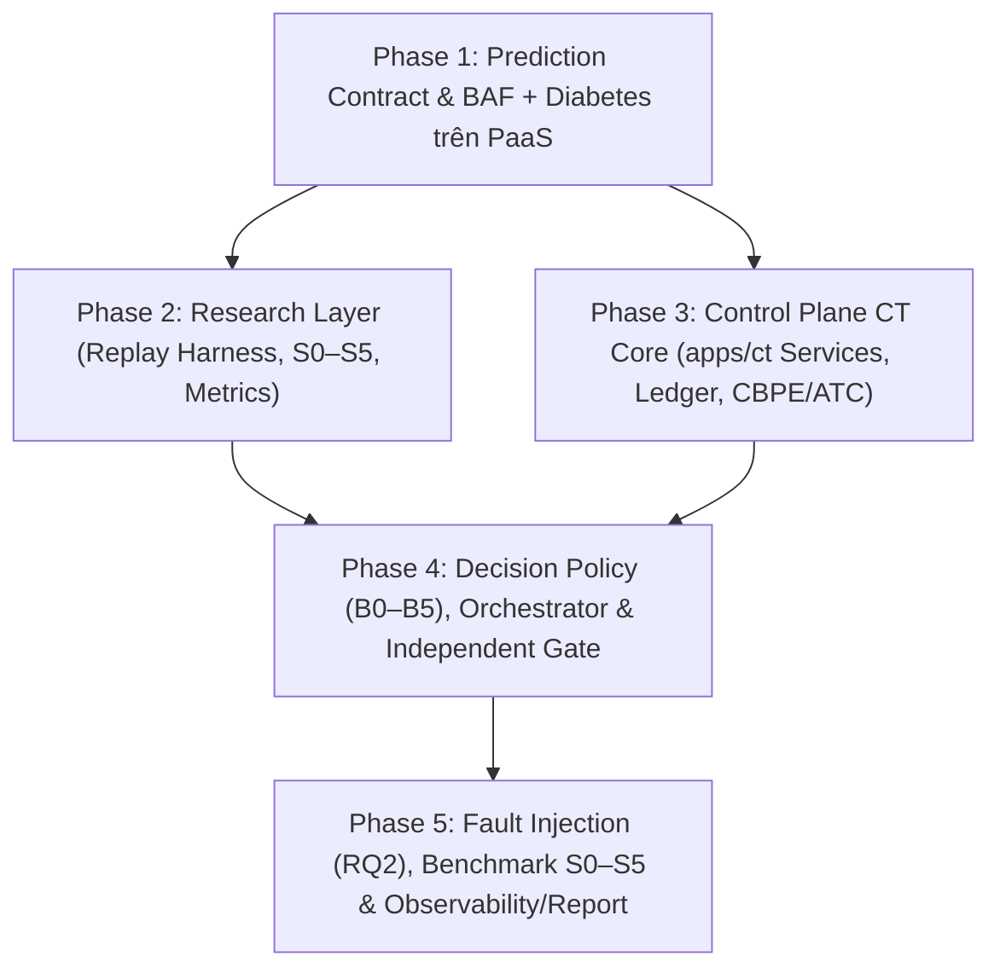

# Lộ trình Thực hiện Chi tiết — Khóa luận Continuous Training

> Lộ trình này chuyển hóa định hướng từ [thesis-overview-and-progress.md](file:///d:/AI%20Models/mlops-paas-system/docs/target/thesis-overview-and-progress.md) thành các giai đoạn kỹ thuật theo đúng thứ tự phụ thuộc trên nền codebase hiện tại (tính từ mốc `26/11/2026`).

---

## 1. Sơ đồ phụ thuộc giữa các Giai đoạn



**Nguyên tắc triển khai:**
1. Mỗi phase phải chạy được end-to-end với test tự động và artifact kiểm chứng được trước khi qua phase sau.
2. Giữ tách biệt **Research Layer** (`research/`) khỏi **Production Layer** (`services/`), nhưng dùng chung một *data contract*, *estimator logic* và *policy semantics* để kết quả thực nghiệm phản ánh đúng hệ thống thật.
3. Không phá vỡ các luồng MLOps PaaS hiện có (`models/nids-xgboost`, Training Workspace, Deploy/Drift hiện tại).

---

## 2. Chi tiết từng Giai đoạn

### Phase 1: Khóa Prediction Contract & Chuẩn hóa 2 Case Study trên PaaS

**Mục tiêu:** Cả **BAF (PyTorch MLP)** và **Diabetes (Logistic Regression)** đều chạy được qua Training Workspace → Model Packager → Model Serving trên MLOps PaaS với xác suất đầu ra chuẩn $0\text{--}1$ và đạt *prediction parity* so với script độc lập.

#### Việc cần làm
1. **Chuẩn hóa Prediction Contract end-to-end:**
   - Rà soát payload trả về từ `services/machine-learning-serving` và `services/deep-learning-serving`, gateway `services/model-server` và ingest ở `services/consumer` để điền đầy đủ các trường đã có trong [PredictionRecord](file:///d:/AI%20Models/mlops-paas-system/services/control-plane/src/apps/production/models.py#L6-L51):
     - `positive_class_probability` $\in [0, 1]$
     - `decision_threshold` $\in [0, 1]$
     - `class_mapping`, `calibration_version`, `latency_ms`, `request_id`
   - Giữ tương thích ngược cho trường `confidence` (%) của các API/UI hiện tại.
2. **Đưa Primary Case BAF (`models/baf-mlp`) lên MLOps PaaS:**
   - Chuyển [models/baf-mlp/training/kaggle/train.py](file:///d:/AI%20Models/mlops-paas-system/models/baf-mlp/training/kaggle/train.py) thành cấu trúc `models/baf-mlp/training/input/` tương thích hoàn toàn với `training-runner` (Output Contract v2).
   - Xây dựng inference wrapper cho `deep-learning-serving` / `model-packager` sao cho nạp được đồng thời `preprocessor.joblib` + `model.pt` + `threshold` + `input_schema.json` + `label_mapping.json`.
   - Kiểm tra dữ liệu nguồn BAF (`Base.csv` và Variant để phục vụ stress test): xuất sẵn các tập theo tháng:
     - `months 0–3` (initial train), `month 4` (validation/threshold), `month 5` (reference/calibration), `months 6–7` (CT replay stream).
3. **Chuẩn hóa Secondary Case Diabetes (`models/diabetes-logreg`):**
   - Kiểm tra `models/diabetes-logreg/training/input/train.py` trả về đủ `positive_class_probability`, `threshold`, `input_schema.json`, `label_mapping.json`, `metrics.json`, `fairness_report.json`.
   - Chuẩn bị bộ temporal/hospital split dành riêng cho replay CT (giữ nguyên dữ liệu sạch tách rời các tập train/val/reference/replay).

#### Tiêu chí hoàn thành Phase 1
- Chạy thành công `BAF MLP` từ Training Workspace → Deploy → Predict trên local Docker Compose (MinIO) và xác minh sai số xác suất dự đoán giữa `model-server` và script PyTorch gốc $< 10^{-5}$.
- `PredictionRecord` trong DB lưu đủ `positive_class_probability`, `decision_threshold`, `latency_ms`, `request_id` cho cả BAF và Diabetes.

---

### Phase 2: Research Layer — Deterministic Replay Harness, Scenarios (`S0–S5`) & Metrics

**Mục tiêu:** Xây dựng sandbox thực nghiệm tái lập hoàn toàn (deterministic theo seed & manifest hash) có thể chạy nhanh các vòng mô phỏng theo cửa sổ thời gian với hidden labels và 3 pool độc lập.

#### Cấu trúc thư mục mục tiêu
```text
research/
├── replay/         # Đọc historical snapshots, chia episode/window, quản lý hidden labels & label delay
├── scenarios/      # Định nghĩa & injector cho S0..S5 (covariate shift, harmful drift, calibration drop...)
├── estimators/     # Drift metrics + CBPE (Confidence-Based Performance Estimation) + ATC (Average Thresholded Confidence)
├── policies/       # Cài đặt thống nhất B0, B1, B2, B3, B4 (proposed), B5 (oracle)
├── metrics/        # Quality (PR-AUC, Recall, Brier...), Detection, CT Lifecycle, Label Efficiency
└── experiments/    # Experiment runner, config YAML/JSON, multi-seed runner, ablation & exporter
```

#### Việc cần làm
1. **Replay Harness & Hidden Labels (`research/replay`):**
   - Phát prediction theo thứ tự cửa sổ/thời gian (`months 6–7` ở BAF và các block thời gian/bệnh viện ở Diabetes).
   - Giữ ground truth $Y$ ở trạng thái ẩn; hỗ trợ tham số **label delay** (trễ $k$ bước hoặc trễ theo thời gian xuất viện/theo dõi).
   - Áp đặt cơ chế **3 pool không giao nhau** (`verify`, `train`, `gate`) bằng chỉ số mẫu/khóa duy nhất để đảm bảo không rò rỉ nhãn (*data leakage*) sang gate hoặc giữa verify/train.
2. **Scenario Injector (`research/scenarios`):**
   - Cài đặt đủ 6 kịch bản `S0–S5` cho BAF (thay đổi tỷ lệ fraud, separability, phân phối categorical, calibration/threshold) và Diabetes (thay đổi phân bố nhóm tuổi/bệnh viện, calibration, recall).
3. **Quality Estimators (`research/estimators`):**
   - Cài đặt **CBPE** và **ATC** calibrated trên partition `month 5` / `reference` (không chạm tập train hoặc replay).
   - Cài đặt Verification Engine kết hợp **ước lượng không nhãn (CBPE/ATC)** + **nhãn selective đã mở** + **kiểm tra độ tin cậy theo kích thước mẫu & số positive count** (vì với rare-event như BAF, batch không có fraud label chưa đủ kết luận an toàn).
4. **Metrics Suite (`research/metrics`):**
   - Xuất đầy đủ 4 nhóm chỉ số:
     - *Model Quality:* PR-AUC / AUPRC, ROC-AUC, Recall, Precision, F1, FNR, FPR, Brier score (+ Fairlearn `MetricFrame` cho Diabetes).
     - *Verification & Detection:* Degradation detection rate, Missed degradation rate, False trigger rate, Verification accuracy.
     - *CT Operations:* Retraining count, Unnecessary retraining rate, Time-to-retraining, Recovery time.
     - *Label Efficiency (trọng tâm):* Total labels consumed, `verify`/`train`/`gate` labels, positive labels acquired, cost per verified degradation, $r = B_{\text{labels}} / N_{\text{production}}$.

#### Tiêu chí hoàn thành Phase 2
- Unit test chứng minh replay là **100% deterministic** (cùng seed + config → cùng chuỗi window, sample rank, decision, metrics).
- Unit test chứng minh **không rò rỉ pool** (`verify ∩ train = ∅`, `verify ∩ gate = ∅`, `train ∩ gate = ∅`) và không vượt tổng ngân sách $B_{\text{total}}$.

---

### Phase 3: Control Plane CT Core (`apps/ct` Services, Ledger & API)

**Mục tiêu:** Hiện thực hóa tầng service, Celery task và REST API trên `services/control-plane/src/apps/ct/` dựa trên 11 model DB đã có sẵn trong [ct/models.py](file:///d:/AI%20Models/mlops-paas-system/services/control-plane/src/apps/ct/models.py).

#### Việc cần làm
1. **Evidence Window & Sample Indexing (`apps/ct/services/windows.py`):**
   - Tự động gom `PredictionRecord` theo cửa sổ thời gian/số lượng mẫu vào `EvidenceWindow` + `EvidenceWindowSample` (gán `randomized_rank` deterministic, mặc định `pool="hidden"`).
   - Liên kết với `drift.DriftRun` và chạy CBPE/ATC lưu vào trường `EvidenceWindow.estimator` (JSON).
2. **Label Budget Ledger & Feedback (`apps/ct/services/budget.py`, `labels.py`):**
   - Cài đặt transaction nguyên tử **Reserve → Commit / Release** trên `LabelBudget` và ghi bất biến vào `LabelLedgerEntry` kèm `idempotency_key`:
     - `reserve`: tăng `*_held`, kiểm tra constraint $B_{\text{verify}} + B_{\text{train}} + B_{\text{gate}} \le B_{\text{total}}$.
     - `commit`: khi nhận `Feedback` hợp lệ, chuyển `held → used` và đánh dấu `LabelRequestItem` là `revealed`.
     - `release`: giải phóng `*_held` khi `LabelRequest` hết hạn, hủy hoặc worker lỗi trước khi commit.
   - API tiếp nhận `LabelRequest` và `Feedback` (từ human/evaluator/replay import).
3. **Verification Engine Service (`apps/ct/services/verification.py`):**
   - Đọc drift signal + estimator (CBPE/ATC) + selective `Feedback` thuộc pool `verify`.
   - Tính kết luận xác minh (`degradation_confirmed`, `uncertain`, `healthy`), khoảng bất định, số lượng positive label thu được và lưu vào `EvidenceWindow.verification`.

#### Tiêu chí hoàn thành Phase 3
- Test đồng thời (`concurrency test` trên Postgres): 20 request `reserve` cùng lúc không thể vượt `total_quota` hoặc `verify_quota`/`train_quota`/`gate_quota`.
- Test idempotency: gửi trùng `Feedback` hoặc trùng `LabelRequest` cùng `idempotency_key` không trừ ngân sách lần 2.

---

### Phase 4: Budget-Aware Policy (`B0–B5`), CT Orchestrator & Independent Evaluation Gate

**Mục tiêu:** Nối hoàn chỉnh vòng tự động hóa trên platform: *Evidence Window → Decision (`KEEP` / `REQUEST_LABELS` / `HOLD` / `RETRAIN`) → Dataset Snapshot (`train` pool) → Training Job → Build → Independent Evaluation Gate (`gate` pool) → Promote / Reject / Rollback*.

#### Việc cần làm
1. **Decision Policy Engine (`apps/ct/services/policies.py`):**
   - Cài đặt đủ `B0–B5` khớp với `MaintenancePolicy.policy_kind`, trong đó `B4` (Proposed Policy) kết hợp:
     - Mức độ drift (`DriftRun`),
     - Suy giảm ước lượng + độ không chắc chắn (CBPE/ATC),
     - Bằng chứng thực tế từ nhãn đã mở (`Verification`),
     - Ngân sách khả dụng còn lại (`LabelBudget`).
   - Trả về `MaintenanceDecision` kèm `action`, `reason_code`, `reason_detail`, `evidence` snapshot và `expected_champion`.
2. **CT Orchestrator & State Machine (`apps/ct/services/orchestrator.py`, `apps/ct/tasks.py`):**
   - Khi quyết định là `RETRAIN`:
     - Tạo `DatasetSnapshot` (`role="retrain"`) lấy dữ liệu từ reference/initial train kết hợp **chỉ các mẫu thuộc pool `train`** đã mở nhãn (tuyệt đối không lấy lẫn `verify`/`gate` hay `workspace latest` tùy tiện).
     - Khởi tạo `MaintenanceRun` (được bảo vệ bởi constraint *1 active run per project*) và tạo `MaintenanceStepAttempt` theo từng bước `snapshot → training → build → gate → update → verify_runtime`.
   - Hỗ trợ **Outbox / Reconciliation / Lease / Deadline**: Celery beat quét định kỳ các run quá hạn (`deadline_at`) hoặc callback bị lỡ để reconcile trạng thái an toàn.
3. **Independent Evaluation Gate (`apps/ct/services/gate.py`):**
   - Tạo `gate_snapshot` (`role="gate"`) hoàn toàn độc lập từ pool `gate` (hoặc historical holdout chưa từng chạm lúc verify/train/tune).
   - Chạy đánh giá song song **Candidate** vs **Expected Champion** trên cùng `gate_snapshot` theo metric chính của domain (PR-AUC / Recall / Brier trên BAF; Balanced Accuracy / ROC-AUC / Recall trên Diabetes).
   - **Quy tắc an toàn:**
     - `pass`: Candidate vượt Champion theo ngưỡng margin định trước và không vi phạm guardrail (calibration/FNR/health check) → cập nhật alias Champion và deploy có kiểm tra health (`verify_runtime`).
     - `fail` / `hold` / `error`: Ghi `EvaluationGate.reason`, giữ nguyên Champion cũ đang phục vụ (hoặc rollback nếu `verify_runtime` sau deploy thất bại).

#### Tiêu chí hoàn thành Phase 4
- Một vòng CT hoàn chỉnh chạy end-to-end trên local Docker Compose tạo đủ chuỗi lineage: `EvidenceWindow → LabelRequest/Feedback → MaintenanceDecision → MaintenanceRun → DatasetSnapshot → TrainingJob → Build → EvaluationGate → Champion Update / Hold`.
- Gate `fail` hoặc candidate crash-loop **100% không làm mất Champion hiện tại**.

---

### Phase 5: Fault Injection (RQ2), Benchmark Thực nghiệm (`S0–S5` × `B0–B5`), UI & Báo cáo

**Mục tiêu:** Chạy đủ bộ thực nghiệm định lượng trả lời RQ1 và RQ2, hoàn thiện dashboard quan sát CT và viết luận văn/demo bảo vệ.

#### Việc cần làm
1. **Chiến dịch Fault Injection cho RQ2 (`services/control-plane/src/apps/ct/tests/test_fault_injection.py`):**
   - Viết test suite mô phỏng 7 kịch bản lỗi theo protocol:
     1. Reserve quota đồng thời dưới tranh chấp (concurrent race).
     2. Worker dừng/crash ngay sau khi commit hoặc trước khi callback.
     3. Callback trễ, lặp lại (duplicate webhook), hoặc đảo thứ tự.
     4. Training job timeout / thất bại giữa chừng.
     5. Candidate deploy crash-loop / failed health check ở `verify_runtime`.
     6. Champion bị thay đổi thủ công giữa lúc `MaintenanceRun` đang chạy (`expected_champion` mismatch).
     7. Gate `fail` / thiếu nhãn ở `gate` pool.
   - Xác minh 5 bất biến nghiệm thu (xem mục 3 bên dưới).
2. **Chạy Benchmark Thực nghiệm cho RQ1 (`research/experiments/`):**
   - Chạy ma trận **6 scenarios (`S0–S5`) × 6 baselines (`B0–B5`)** với nhiều random seeds (ví dụ 5 seeds) trên:
     - **Primary:** BAF + PyTorch MLP (kèm khảo sát độ nhạy tham số / *ablation study*: ngưỡng uncertainty, kích thước `verify` batch, tổng ngân sách $B_{\text{total}}$).
     - **Secondary:** Diabetes + Logistic Regression (kèm phân tích phụ Fairlearn `MetricFrame` giữa các subgroup).
   - Lưu toàn bộ kết quả kèm `seed`, `snapshot_hash`, `policy_version`, khoảng bất định (mean ± std / CI), sinh bảng & biểu đồ cho báo cáo.
3. **Observability & UI trên `web/` (Should-have cho demo trực quan):**
   - Thêm tab/panel **Continuous Training** trong Project Overview / Evolution để hiển thị:
     - Trạng thái `LabelBudget` (Remaining / Held / Used theo 3 pool `verify`, `train`, `gate`).
     - Timeline các `EvidenceWindow`, điểm Drift vs Estimated Quality (CBPE/ATC).
     - Lịch sử `MaintenanceDecision` (`KEEP`/`REQUEST_LABELS`/`HOLD`/`RETRAIN` kèm lý do) và `EvaluationGate` (`PASS`/`FAIL`/`HOLD`).
4. **Kiểm chứng Cloud/Production (tùy tài nguyên sẵn có) & Hoàn thiện Luận văn:**
   - Chạy tối thiểu 1 vòng smoke test end-to-end trên K3s / Argo Workflows (nếu bật cụm AWS) hoặc kiểm chứng đầy đủ trên Docker Compose + MinIO.
   - Tổng hợp số liệu, biểu đồ, bảng kết quả, phần giới hạn (threats to validity) và kịch bản demo bảo vệ khóa luận.

---

## 3. Các Bất biến Nghiệm thu Bắt buộc (Acceptance Invariants)

Khóa luận chỉ được coi là hoàn tất khi toàn bộ hệ thống và bộ thực nghiệm thỏa mãn 5 bất biến sau:

1. **Bảo toàn ngân sách nhãn:** $B_{\text{verify}} + B_{\text{train}} + B_{\text{gate}} \le B_{\text{total}}$ không bao giờ bị phá vỡ trong mọi điều kiện đồng thời hoặc retry.
2. **Không trùng lặp thực thi:** Không tạo logical `MaintenanceRun`, `TrainingJob` hoặc trừ `LabelLedgerEntry` trùng lặp khi webhook/task bị gửi lại.
3. **Không rò rỉ dữ liệu đánh giá:** Tập mẫu trong `verify`, `train` và `gate` hoàn toàn tách biệt; `EvaluationGate` không bao giờ đánh giá trên dữ liệu đã dùng để train hoặc verify.
4. **Bảo vệ Champion tuyệt đối:** Candidate fail, hold, timeout hoặc crash-loop **không bao giờ** làm gián đoạn hoặc ghi đè Champion đang phục vụ.
5. **Lineage đầy đủ 100%:** Mọi quyết định CT đều truy vết được ngược về `DatasetSnapshot` hash, `EvidenceWindow`, kết quả estimator/drift, `LabelLedgerEntry`, `TrainingJob`, `Build` và `EvaluationGate`.
