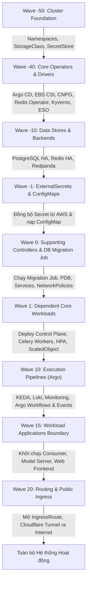

# Kubernetes (K8s) - Quản trị Hạ tầng Khai báo & GitOps (Declarative GitOps Platform)

Thư mục `k8s/` chứa toàn bộ cấu hình khai báo (Declarative Manifests) quản lý toàn bộ vòng đời hạ tầng phần mềm, các dịch vụ nền tảng (Platform Services), pipeline thực thi MLOps (Argo Workflows/Events) và các ứng dụng vi dịch vụ (Microservices) của hệ thống MLOps PaaS theo mô hình **GitOps**.

---

## 1. Giới thiệu

### 1.1. Vai trò trong hệ thống
Trong kiến trúc tổng thể, `k8s/` đóng vai trò là **Nguồn chân lý duy nhất (Single Source of Truth - SSOT)** cho toàn bộ cụm Kubernetes:
- Mọi tài nguyên trong cụm Kubernetes (Namespace, StorageClass, CRD, RBAC, NetworkPolicy, StatefulSet, Deployment, Service, IngressRoute) đều được mô tả tường minh bằng code (Kustomize & Helm Charts).
- **Argo CD** đóng vai trò là Controller liên tục đối soát trạng thái mong muốn (*Desired State*) trên nhánh Git `main` với trạng thái thực tế (*Live State*) trên cụm K3s. Bất kỳ sự sai lệch (*Drift*) nào sẽ được tự động đồng bộ hóa (*Self-heal*).
- Không có bất kỳ thay đổi nào được tạo ra bằng các lệnh `kubectl apply/edit` thủ công ngoài môi trường sản xuất; mọi cập nhật đều phải thông qua Git Commit / Pull Request.

```text
+-----------------------------------------------------------------------------------+
|                                 GitHub Repository                                 |
|                               (Nhánh main / k8s/)                                 |
+-----------------------------------------------------------------------------------+
                                         │
                         Tự động phát hiện thay đổi (GitOps)
                                         ▼
+-----------------------------------------------------------------------------------+
|                        Argo CD (Root App: mlops-paas-system)                      |
|                  Điều phối đồng bộ theo 5 Mặt phẳng (5 Planes)                    |
+-----------------------------------------------------------------------------------+
     │                │                 │                  │                │
     ▼                ▼                 ▼                  ▼                ▼
[1. Cluster]    [2. Addons]       [3. Platform]      [4. Execution]   [5. Workloads]
- Namespaces    - Argo CD (Self)  - Postgres HA      - EventBus       - Control Plane
- StorageClass  - ExternalSecrets - Redis HA         - EventSource    - Celery Workers
- Karpenter     - KEDA / Loki     - Observability    - Pipelines      - Model Server
- Keyless Cosign- Kubeflow / Alloy- Harbor / Traefik - NetworkPolicies- Web Frontend
```

---

### 1.2. Các thành phần chính (Kiến trúc 5 Mặt phẳng - System Planes)

Hệ thống được chia thành 5 mặt phẳng độc lập tương ứng với các **Argo CD AppProject**:

| Mặt phẳng (Plane) | Đường dẫn mã nguồn | Argo CD AppProject | Trách nhiệm chính |
|---|---|---|---|
| **GitOps Control Plane** | `k8s/gitops/production` | `default` | Ứng dụng gốc `mlops-paas-system` quản lý AppProject và 35 Child Application. |
| **Cluster Plane** | `k8s/cluster` | `mlops-cluster` | Cấu hình nền tảng cấp cụm: Namespace, StorageClass (`ebs-gp3`), `ClusterSecretStore`, chính sách Kyverno Cosign, cấu hình Karpenter Capacity (NodePools, EC2NodeClasses). |
| **Add-ons Plane** | Charts upstream & `k8s/addons/` | `mlops-addons` | Các Controller/CRD cơ sở: Self-Managed Argo CD, AWS EBS CSI, External Secrets Operator (ESO), CloudNative-PG, Redis Operator, KEDA, Prometheus Stack, Loki, Alloy, Kyverno, Kubeflow Training, Headlamp Dashboard. |
| **Platform Plane** | `k8s/platform` | `mlops-platform` | Các dịch vụ dữ liệu & chia sẻ dùng chung: CSDL PostgreSQL HA (CloudNative-PG), Redis HA + Sentinel, Redpanda Kafka, Harbor Registry, Traefik Routing & Cloudflare Tunnel. |
| **Execution Plane** | `k8s/argo` | `mlops-execution` | Động cơ pipeline MLOps: Argo Events (EventBus, EventSource, Sensor), NetworkPolicies cô lập execution, và các mẫu Argo WorkflowTemplates (Build, Deploy, Delete, Drift, Training, Operations). |
| **Workloads Plane** | `k8s/apps/overlays/production` | `mlops-workloads` | Các microservices nghiệp vụ của tenant và hệ thống: Control Plane API, Celery Worker / Beat / Health-Worker, Model Server Gateway, Redpanda Consumer, Web Frontend. |

---

### 1.3. Luồng hoạt động & Thứ tự đồng bộ (Sync Wave Ordering)

Để tránh xung đột phụ thuộc (ví dụ: Service khởi động trước khi có Namespace hoặc Database, Workload chạy trước khi Database Migration hoàn tất), Argo CD thực hiện đồng bộ theo các **Sync Wave** nghiêm ngặt:



- **Wave -50:** `mlops-prod-cluster-namespaces`, `mlops-prod-cluster-storage` (tạo toàn bộ namespace và StorageClass trước).
- **Wave -40:** Cài đặt các operator hạ tầng và Self-Managed Argo CD (`mlops-prod-addon-argocd`, `redis-operator`, `cloudnative-pg`, `external-secrets`, `aws-ebs-csi`).
- **Wave -10:** Khởi tạo các cụm lưu trữ dữ liệu nền tảng (`mlops-prod-platform-postgres`, `mlops-prod-platform-redis`, `mlops-prod-platform-redpanda`).
- **Wave -1:** Đồng bộ các `ExternalSecret` tương ứng tại từng workload từ AWS Secrets Manager và nạp các `ConfigMap`.
- **Wave 0:** Khởi tạo tài nguyên cơ sở ứng dụng, Services, PodDisruptionBudgets, NetworkPolicies và thực thi **Database Migration Job** (`mlops-paas-control-plane-migration` với `argocd.argoproj.io/hook: Sync`).
- **Wave 1:** Triển khai các Pod nghiệp vụ phụ thuộc vào schema Database đã sẵn sàng (`control-plane`, `celery-worker`, `celery-beat`, `celery-health-worker`, `hpa`, `celery-worker-scaler`).
- **Wave 10 - 15:** Kích hoạt pipeline MLOps (`execution-argo`), `consumer`, `model-server`, `web`.
- **Wave 20:** Kích hoạt routing ngoài (`routing`, `cloudflare`), mở cổng an toàn cho người dùng truy cập.

> [!NOTE]
> **Nguyên tắc "Pure Kubernetes Base via Kustomize Patches":**
> Toàn bộ các manifest trong `k8s/apps/base/` được giữ sạch 100%, không chứa các annotation đặc thù của Argo CD (`argocd.argoproj.io/sync-wave`). Toàn bộ luồng điều phối Sync Wave 3 bước (`ExternalSecret: -1` -> `Migration Job: 0` -> `Workloads: 1`) được inject thông qua cơ chế `patches` tại `k8s/apps/overlays/production/control-plane/kustomization.yaml`.

> [!TIP]
> **Mô hình Self-Managed Argo CD (GitOps Tự Quản lý):**
> Hệ thống áp dụng nguyên tắc phân tách ranh giới rõ ràng:
> - **Day-0 (Bootstrap):** Ansible giữ vai trò mồi nổ ban đầu: cài đặt K3s, cài đặt Helm chart `argocd` và áp dụng Root Application `mlops-paas-system`.
> - **Day-1+ (GitOps Lifecycle):** Child Application `mlops-prod-addon-argocd` (Wave -40) chính thức tiếp quản quyền sở hữu Helm release `argocd`. Mọi tinh chỉnh cấu hình `values` và nâng cấp phiên bản diễn ra hoàn toàn qua Git Pull Request với cơ chế `ServerSideApply=true`. Trong trường hợp sự cố khẩn cấp (Disaster Recovery), Ansible Playbook sẵn sàng chạy lại để cứu hộ.

---

### 1.4. Kiến trúc Cô lập Mạng & Bảo mật Zero Trust (Network Policies)

Hệ thống triển khai mô hình phòng thủ theo chiều sâu (**Defense-in-Depth**) bằng cách áp dụng `NetworkPolicy` nghiêm ngặt trên toàn bộ các namespace:

```text
                                [Traefik Ingress]
                                        │
                         TCP 8000       │ TCP 5000
              ┌─────────────────────────┴────────────────────────┐
              ▼                                                  ▼
┌───────────────────────────┐                      ┌───────────────────────────┐
│   mlops-paas-core         │                      │   mlops-paas-core         │
│   [control-plane API]     │                      │   [model-server Gateway]  │
└─────────────┬─────────────┘                      └─────────────┬─────────────┘
              │ TCP 8000 (Webhook/MLflow)                        │ TCP 5001, 5002
              │                                                  ▼
              │                                    ┌───────────────────────────┐
              │                                    │   mlops-paas-serving      │
              │                                    │   [Model Inference Pods]  │
              │                                    │   • Ingress: ONLY gateway │
              │                                    │   • Blocked: AWS IMDS     │
              │                                    └───────────────────────────┘
              ├──────────────────────────────────────────────────┐
              ▼                                                  ▼
┌───────────────────────────┐                      ┌───────────────────────────┐
│   mlops-paas-training     │                      │   mlops-paas-execution    │
│   [Training Runner Pods]  │                      │   [Build, Drift, Ops]     │
│   • Ingress: ONLY PyTorch │                      │   • Ingress: DENY ALL     │
│     DDP nội bộ (23456)    │                      │   • Build: Harbor, S3     │
│   • Egress: S3, PyPI, API │                      │   • Evidently: Postgres RO│
│   • Blocked: AWS IMDS, DB │                      │   • Ops: K8s API, Webhook │
│     & Pod CIDR nội bộ     │                      │   • Blocked: AWS IMDS     │
└───────────────────────────┘                      └─────────────┬─────────────┘
                                                                 │ TCP 5432 (RO)
                                                                 ▼
                                                   ┌───────────────────────────┐
                                                   │   mlops-paas-data         │
                                                   │   [PostgreSQL HA Cluster] │
                                                   │   • RW: Core API          │
                                                   │   • RO: Evidently Drift   │
                                                   └───────────────────────────┘
```

1. **`mlops-paas-serving` (Model Runtimes):**
   - Các Pod suy luận mô hình (`machine-learning-serving`, `deep-learning-serving`) là stateless, **không có lớp xác thực riêng**.
   - `NetworkPolicy` chỉ cho phép Ingress duy nhất từ `model-server` (Trusted Gateway) trên các cổng `5001` (ML) và `5002` (DL), cùng Prometheus scraper.
   - Egress bị hạn chế nghiêm ngặt: chỉ cho phép CoreDNS (53) và HTTPS (443) tải artifact; **chặn hoàn toàn AWS Metadata (`169.254.169.254`)** và toàn bộ mạng nội bộ RFC1918.

2. **`mlops-paas-training` (Untrusted Training Sandbox):**
   - Thực thi mã nguồn Python do người dùng tải lên (**Hostile Untrusted Workloads**).
   - Ingress từ bên ngoài bị chặn 100%; chỉ cho phép giao tiếp nội bộ giữa các worker PyTorch DDP trên cổng `23456`.
   - Egress chỉ cho phép: CoreDNS (53), Control Plane API (`mlops-paas-core:8000`) cho MLflow/Presigned URLs, và HTTPS/HTTP ra ngoài để tải dữ liệu/thư viện.
   - **Tuyệt đối cấm kết nối tới AWS Instance Metadata Service (`169.254.169.254`)** và các cụm dữ liệu nội bộ (`mlops-paas-data`).

3. **`mlops-paas-execution` (Execution Pipelines):**
   - **Chính sách chung (`shared/`):** Áp dụng `default-deny-all-ingress-execution` chặn toàn bộ traffic đi vào namespace (do các workflow pod đều là batch/worker tác vụ một chiều).
   - **`build` (Kaniko Packager):** Egress tới CoreDNS, Control Plane Webhook (`8000`), Harbor nội bộ/public (`443/80`), và S3. Chặn AWS IMDS.
   - **`evidently` (Drift Analyzer):** Egress tới CoreDNS, PostgreSQL Read-Only (`postgresql-ro.mlops-paas-data:5432`), S3 (`443`), Control Plane (`8000`). Chặn AWS IMDS và các dịch vụ khác.
   - **`operations` (Job Ops Controller):** Egress tới CoreDNS, Kubernetes API Server (`443/6443`), và Control Plane observation callback (`8000`).

---

## 2. Cấu trúc cây thư mục

```text
k8s/
├── kustomization.yaml                  # Kustomize entrypoint gốc của toàn bộ kho mã nguồn
├── README.md                           # Tài liệu kiến trúc và hướng dẫn vận hành GitOps K8s
├── addons/                             # Remote overlays cho các Addons bên thứ ba
│   └── kubeflow-training/              # Kustomize overlay triển khai Kubeflow Training Operator
├── argocd/                             # Định nghĩa ứng dụng gốc Argo CD
│   ├── application.yaml                # Manifest Root Application (mlops-paas-system)
│   └── values.yaml                     # Helm values tùy chỉnh cho Argo CD server
├── cluster/                            # Cấu hình cụm dùng chung (Cluster Foundation Plane)
│   ├── capacity/                       # Karpenter NodeClasses & NodePools (CPU/GPU)
│   ├── image/                          # Chính sách kiểm tra chữ ký ảnh Keyless Cosign (Kyverno)
│   ├── namespaces/                     # Khai báo toàn bộ production namespaces của hệ thống
│   ├── secret-store/                   # ClusterSecretStore liên kết AWS Secrets Manager
│   └── storage/                        # Khai báo AWS EBS gp3 StorageClass & VolumeSnapshotClass
├── gitops/                             # Định nghĩa cấu trúc phân tầng Argo CD (App-of-Apps)
│   └── production/                     # Môi trường production
│       ├── kustomization.yaml          # Tổng hợp projects, repositories và applications
│       ├── projects/                   # 5 AppProject kiểm soát quyền hạn (cluster, addons, platform, execution, workloads)
│       ├── repositories/               # Cấu hình Git repository nguồn có xác thực
│       └── applications/               # Định nghĩa 35 Argo CD Child Application
│           ├── cluster/                # Ứng dụng cấu hình nền tảng cụm
│           ├── addons/                 # Ứng dụng cài đặt các Helm Chart bên thứ ba
│           ├── platform/               # Ứng dụng dịch vụ nền tảng (Postgres, Redis, Redpanda, Harbor, Logging)
│           ├── execution/              # Ứng dụng quản lý pipeline Argo Events/Workflows
│           └── workloads/              # Ứng dụng nghiệp vụ người dùng (Control Plane, Celery, Model Server, Web)
├── platform/                           # Manifest chi tiết của các dịch vụ nền tảng (Platform Plane)
│   ├── postgres/                       # CloudNative-PG Cluster HA, Pooler, NetworkPolicy, Backup
│   ├── redis/                          # Redis HA Master-Replica + Redis Sentinel (3 nodes) & NetworkPolicy
│   ├── redpanda/                       # Redpanda Kafka Broker StatefulSet, Services & NetworkPolicy
│   ├── harbor/                         # Cấu hình Container Registry nội bộ Harbor & Ingress
│   ├── observability/                  # ServiceMonitors, PodMonitors, PrometheusRules
│   ├── cloudflare/                     # Cloudflare Tunnel Daemon kết nối ra ngoài an toàn
│   └── routing/                        # Traefik IngressRoute, Middleware định tuyến tên miền
├── argo/                               # Hạ tầng điều phối tác vụ MLOps (Execution Plane)
│   ├── kustomization.yaml              # Entrypoint tổng hợp events và workflows
│   ├── events/                         # Argo Events: EventBus, EventSource, Sensor, NetworkPolicy
│   └── workflows/                      # Các mẫu template pipeline MLOps & NetworkPolicies
│       ├── shared/                     # ConfigMap dùng chung, RBAC chung, default-deny NetworkPolicy
│       ├── operations/                 # Python script job_ops.py, WorkflowTemplates submit/reconcile, NetworkPolicy
│       ├── build/                      # WorkflowTemplate đóng gói mô hình Kaniko, ExternalSecret, NetworkPolicy
│       ├── deploy/                     # WorkflowTemplate triển khai model endpoint, RBAC, NetworkPolicy cho serving
│       ├── training/                   # WorkflowTemplate huấn luyện PyTorchJob, ExternalSecret, NetworkPolicy cho training
│       └── evidently/                  # WorkflowTemplate kiểm tra data/model drift, ExternalSecret, NetworkPolicy
├── apps/                               # Mã nguồn Kubernetes của các Microservices ứng dụng (Workloads Plane)
│   ├── base/                           # Manifest cơ sở thuần túy (pure K8s, environment-agnostic)
│   │   ├── control-plane/              # Deployment Django API, Celery Workers, Migration Job, Service, HPA, PDB
│   │   ├── consumer/                   # Deployment Redpanda consumer tiếp nhận sự kiện suy luận
│   │   ├── model-server/               # Deployment Model Server Gateway điều phối suy luận & xác thực JWT
│   │   └── web/                        # Deployment ReactJS frontend dashboard
│   └── overlays/                       # Cấu hình ghi đè theo môi trường (Environment Overlays)
│       └── production/                 # Overlay cụ thể cho Production (Kustomize Patches inject Sync Waves, Images, Secrets)
└── validate/                           # Bộ kiểm thử tự động xác thực tính toàn vẹn và an toàn Manifest
    ├── tests/                          # 36 bài test tự động với pytest (Job operations, Runtime health, Validators)
    ├── common.py                       # Thư viện dùng chung phân tích cú pháp Kustomize và AST manifest
    ├── run_all.py                      # CLI entrypoint thực thi toàn bộ 9 nhóm kiểm thử GitOps độc lập
    ├── validate_application_contract.py # Kiểm tra hợp đồng ranh giới Application và Sync Waves
    ├── validate_cluster_capacity.py    # Kiểm tra cấu hình Karpenter NodePool và taint GPU
    ├── validate_execution_security.py  # Kiểm tra bảo mật webhook Argo Events, token secret và RBAC
    ├── validate_helm_sources.py        # Kiểm tra tính toàn vẹn nguồn Helm Chart của Addons
    ├── validate_redis_ha.py            # Kiểm tra cấu hình Sentinel quorum, topology spread và secret
    ├── validate_resource_ownership.py  # Kiểm tra tính đơn nhất và quyền sở hữu danh tính tài nguyên
    ├── validate_runtime_logging.py     # Kiểm tra quyền thu thập log an toàn của Alloy/Loki
    ├── validate_secrets.py             # Kiểm tra quy ước ExternalSecret (Sync Wave -1, SecretStoreRef)
    └── validate_supply_chain.py        # Kiểm tra Kyverno Cosign verification và quyền Kaniko
```

---

## 3. Hướng dẫn khởi chạy và các lệnh cần thiết

### 3.1. Kiểm tra tính hợp lệ trước khi đẩy mã nguồn (Local Validation)
Trước khi commit hoặc tạo PR thay đổi cấu hình Kubernetes, bắt buộc phải chạy bộ kiểm tra tĩnh:

```bash
# 1. Chạy toàn bộ 36 bài kiểm tra tự động độc lập (Offline Validators test suite):
python -m pytest k8s/validate/tests/ -v

# 2. Chạy các validator GitOps độc lập (Core Checks):
python -m k8s.validate.validate_application_contract
python -m k8s.validate.validate_execution_security
python -m k8s.validate.validate_secrets
python -m k8s.validate.validate_supply_chain
python -m k8s.validate.validate_cluster_capacity
python -m k8s.validate.validate_redis_ha
python -m k8s.validate.validate_runtime_logging

# 3. Chạy toàn bộ 9 nhóm kiểm thử trên môi trường CI (Yêu cầu có sẵn Helm & Kubeconform):
python -m k8s.validate.run_all

# 4. Kiểm tra kết xuất cú pháp Kustomize cho các tầng:
kubectl kustomize k8s/apps/overlays/production/control-plane >/dev/null
kubectl kustomize k8s/argo >/dev/null
```

Bộ kiểm tra tự động sẽ xác thực:
- Tính nhất quán của các `ExternalSecret` (bắt buộc dùng `sync-wave: "-1"` và `ClusterSecretStore`).
- Ràng buộc cấu hình Redis HA (đúng tên secret, đúng số replica, không lộ mật khẩu, quorum Sentinel).
- Ranh giới Application và cấu hình Sync Waves của từng mặt phẳng.
- Quyền hạn RBAC tối thiểu (Least Privilege), cấm cấp quyền `secrets`, `pods/exec` cho worker.
- Bảo mật chuỗi cung ứng (Kyverno Cosign verification và non-root Kaniko).
- Khả năng chống chịu lỗi (PodDisruptionBudget, Pod Anti-Affinity và TopologySpreadConstraints).

---

### 3.2. Giám sát và Quản trị ứng dụng qua Argo CD CLI / Kubectl

Kết nối trực tiếp tới cụm K3s (hoặc qua SSH tunnel):

```bash
# 1. Liệt kê toàn bộ các Application cùng trạng thái Sync và Health:
kubectl get applications -n argocd -o custom-columns=NAME:.metadata.name,SYNC:.status.sync.status,HEALTH:.status.health.status

# 2. Xem chi tiết trạng thái hoặc lỗi của một Application cụ thể:
kubectl get application mlops-prod-workloads-control-plane -n argocd -o yaml

# 3. Yêu cầu Argo CD kiểm tra lại mã nguồn Git ngay lập tức (Hard Refresh):
kubectl annotate application mlops-paas-system -n argocd argocd.argoproj.io/refresh=hard --overwrite

# 4. Kích hoạt đồng bộ thủ công có dọn dẹp tài nguyên thừa (Force Sync & Prune):
kubectl patch application <application-name> -n argocd --type merge -p '{"operation":{"sync":{"prune":true}}}'
```

---

### 3.3. Quy trình Triển khai / Nâng cấp (Deployment Workflow)

1. **Cập nhật mã nguồn hoặc Image Tag:**
   - Khi CI/CD xây dựng image mới, GitHub Actions sẽ cập nhật `newTag` trong file [k8s/apps/overlays/production/\<service\>/kustomization.yaml](file:///d:/AI%20Models/mlops-paas-system/k8s/apps/overlays/production/).
2. **Tạo Pull Request và Merge vào `main`:**
   - Mọi thay đổi cấu hình hạ tầng đều bắt buộc thông qua PR và vượt qua toàn bộ test CI.
3. **Argo CD tự động đối soát:**
   - Trong vòng 3 phút (hoặc ngay lập tức nếu kích hoạt Webhook), Argo CD sẽ phát hiện commit mới và tiến hành cập nhật rolling update pod mà không làm gián đoạn dịch vụ.

---

## 4. Các chú ý quan trọng (Important Notes)

> [!CAUTION]
> **Không sửa trực tiếp trên Cụm (No Ad-hoc Mutations):**
> Tuyệt đối không dùng lệnh `kubectl edit` hay `kubectl apply` để sửa đổi tài nguyên do Argo CD quản lý trên cluster. Cơ chế `selfHeal: true` của Argo CD sẽ tự động phát hiện và ghi đè lại cấu hình từ Git, làm mất toàn bộ các chỉnh sửa thủ công của bạn.

> [!WARNING]
> **Bảo mật Secret và Quy ước Sync Wave -1:**
> - Tuyệt đối không commit file chứa dữ liệu mật (`Secret` thật với base64) vào Git.
> - Mọi mật khẩu và API token phải được đẩy lên **AWS Secrets Manager** bằng script quản trị.
> - Toàn bộ manifest `ExternalSecret` trong Git bắt buộc sử dụng **Wave `-1`** và khai báo 4 trường defaulting để tránh drift:
>   ```yaml
>   conversionStrategy: Default
>   decodingStrategy: None
>   metadataPolicy: None
>   nullBytePolicy: Ignore
>   ```

> [!IMPORTANT]
> **Phòng chống đánh cắp Node Credentials (Chặn AWS IMDS):**
> Mọi workload untrusted (Training Runner, Model Serving, Kaniko Packager) đều được áp dụng `NetworkPolicy` chặn hoàn toàn dải IP metadata máy chủ đám mây `169.254.169.254/32`. Điều này ngăn chặn triệt để nguy cơ mã độc đánh cắp IAM Role của node qua IMDSv1/v2.

> [!IMPORTANT]
> **Chính sách Xác thực Chữ ký Ảnh Container (Kyverno Keyless Cosign):**
> Toàn bộ image thuộc namespace hệ thống (`registry.mlops-nids-nt114.id.vn/mlops-paas/*`) bắt buộc phải được ký điện tử không khóa (**Keyless Cosign**) bởi GitHub Actions workflow `cd.yml` trên nhánh `main`. Kyverno sẽ từ chối khởi chạy (*Admission Denied*) bất kỳ container nào chưa được ký hoặc ký sai danh tính OIDC.

> [!TIP]
> **Bảo trì Cụm Redis HA & PostgreSQL HA:**
> - Cụm Redis HA sử dụng mô hình 2 Redis Data Nodes + 3 Sentinel Nodes. Sentinel đạt quorum khi có tối thiểu 2 node đồng thuận.
> - Cụm PostgreSQL sử dụng CloudNative-PG với 2 instance đồng bộ streaming replication và `podAntiAffinityType: required`.
> - Khi cần drain hoặc restart node bảo trì, chỉ được thao tác **từng node một** (`one node at a time`) và luôn kiểm tra quorum phục hồi trước khi chuyển sang node tiếp theo.
