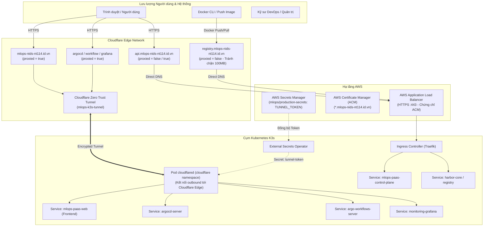

# Cloudflare Infrastructure as Code (`terraform/cloudflare`)

Mã nguồn Terraform quản lý hạ tầng **Cloudflare DNS**, **Zero Trust Tunnel**, và **Bảo mật Zone** cho nền tảng MLOps PaaS.

Dự án này được thiết kế theo **Phương thức B (Decoupled State via `terraform.tfvars`)**: Hoạt động hoàn toàn độc lập với [`terraform/aws`](../aws/), không chia sẻ file state, loại bỏ triệt để rủi ro xóa chéo tài nguyên khi bảo trì hoặc dọn dẹp hạ tầng.

---

## 1. Kiến trúc Tổng thể



---

## 2. Bảng định tuyến & Dịch vụ

| Tên miền | Loại bản ghi | Đích đến (`content`) | Cloudflare Proxy | Mục đích sử dụng |
|---|---|---|---|---|
| `mlops-nids-nt114.id.vn` | `CNAME` | `<tunnel_id>.cfargotunnel.com` | **BẬT (`proxied = true`)** | Web Dashboard & Suy luận mô hình |
| `argocd.mlops-nids-nt114.id.vn` | `CNAME` | `<tunnel_id>.cfargotunnel.com` | **BẬT (`proxied = true`)** | Dashboard GitOps quản trị K3s |
| `workflow.mlops-nids-nt114.id.vn` | `CNAME` | `<tunnel_id>.cfargotunnel.com` | **BẬT (`proxied = true`)** | Dashboard giám sát Argo Workflows |
| `grafana.mlops-nids-nt114.id.vn` | `CNAME` | `<tunnel_id>.cfargotunnel.com` | **BẬT (`proxied = true`)** | Dashboard giám sát Metrics & Logs |
| `api.mlops-nids-nt114.id.vn` | `CNAME` | AWS ALB DNS | **TẮT (`proxied = false`)** | REST API Control Plane (tránh timeout khi upload lớn) |
| `registry.mlops-nids-nt114.id.vn` | `CNAME` | AWS ALB DNS | **TẮT (`proxied = false`)** | Harbor Registry (**Bắt buộc** để không bị giới hạn 100 MB) |
| `_*.mlops-nids-nt114.id.vn` | `CNAME` | AWS ACM Validation Target | **TẮT (`proxied = false`)** | Xác thực chứng chỉ SSL AWS ACM |

---

## 3. Cấu trúc Thư mục

```text
terraform/cloudflare/
├── provider.tf                  # Khai báo phiên bản provider (cloudflare ~> 4.40, random ~> 3.6) & Provider Token
├── variables.tf                 # Khai báo biến đầu vào & cấu hình mặc định (kèm email OTP cho Argo Workflows)
├── terraform.tfvars.example     # File mẫu cấu hình biến người dùng
├── main.tf                      # Root module kết nối 4 submodules
├── outputs.tf                   # Xuất tunnel_token, endpoints, Access Application ID
├── README.md                    # Tài liệu hướng dẫn sử dụng này
└── modules/
    ├── dns/                     # Module quản lý toàn bộ bản ghi DNS
    │   ├── main.tf
    │   ├── variables.tf
    │   └── outputs.tf
    ├── tunnel/                  # Module quản lý Zero Trust Tunnel & Ingress Rules
    │   ├── main.tf
    │   ├── variables.tf
    │   └── outputs.tf
    ├── security/                # Module cấu hình SSL Full (Strict), HTTP/3, TLS 1.2+
    │   ├── main.tf
    │   ├── variables.tf
    │   └── outputs.tf
    └── access/                  # Module cấu hình Cloudflare Access (Email OTP) cho Argo Workflows
        ├── main.tf
        ├── variables.tf
        └── outputs.tf
```

---

## 4. Hướng dẫn Triển khai Từng bước

### Bước 1: Chuẩn bị Cloudflare API Token
Tạo Cloudflare API Token tại [Cloudflare Dashboard Profile](https://dash.cloudflare.com/profile/api-tokens) với các quyền sau:
- **Zone** - **DNS**: `Edit`
- **Zone** - **Zone Settings**: `Edit`
- **Zone** - **Access: Apps and Policies**: `Edit` (hoặc **Account** - **Access: Apps and Policies**: `Edit`)
- **Account** - **Cloudflare Tunnel**: `Edit`

Lấy `Account ID` (ở thanh bên phải Dashboard) và `Zone ID` (trong trang Tổng quan tên miền).

### Bước 2: Lấy thông số đầu ra từ AWS Terraform
Di chuyển vào thư mục [`terraform/aws`](../aws/) và trích xuất dữ liệu:
```bash
cd terraform/aws

# 1. Lấy ALB DNS Name
terraform output -raw alb_dns

# 2. Lấy danh sách bản ghi xác thực ACM dạng JSON
terraform output -json acm_ssl_validation_records
```

### Bước 3: Cấu hình `terraform.tfvars`
Quay lại thư mục `terraform/cloudflare`:
```bash
cd ../cloudflare
cp terraform.tfvars.example terraform.tfvars
```
Mở `terraform.tfvars` và điền:
- `cloudflare_api_token`, `cloudflare_account_id`, `cloudflare_zone_id`.
- Dán giá trị `alb_dns_name` và mảng `acm_validation_records` vừa lấy ở Bước 2.
- (Tùy chọn) Điều chỉnh hoặc bổ sung các dịch vụ trong `tunnel_services`.

### Bước 4: Khởi tạo và Triển khai
```bash
terraform init
terraform fmt -check
terraform validate
terraform plan
terraform apply
```

### Bước 5: Nạp `tunnel_token` vào Cụm K3s
Sau khi `terraform apply` thành công, lấy `tunnel_token`:
```bash
terraform output -raw tunnel_token
```

Đồng bộ token vào AWS Secrets Manager bằng script có sẵn của dự án:
```bash
python scripts/create_and_push_secrets_to_aws.py
# Nhập giá trị TUNNEL_TOKEN khi được hỏi
```
Hoặc dùng AWS CLI cập nhật trực tiếp:
```bash
aws secretsmanager update-secret \
  --secret-id mlops/production-secrets \
  --secret-string '{"TUNNEL_TOKEN":"<GIÁ_TRỊ_TUNNEL_TOKEN>"}'
```

External Secrets Operator trên cụm K3s sẽ tự động đồng bộ Secret vào namespace `cloudflare`, và Pod `cloudflared` sẽ kết nối thành công tới Cloudflare Zero Trust.

---

## 5. Tùy biến dịch vụ Tunnel (`tunnel_services`)

Để bổ sung thêm dịch vụ nội bộ kết nối qua Cloudflare Tunnel, bạn chỉ cần khai báo thêm vào map `tunnel_services` trong `terraform.tfvars`:

```hcl
tunnel_services = {
  "@" = {
    service     = "http://mlops-paas-web.mlops-paas-core.svc.cluster.local:80"
    description = "MLOps PaaS Web Dashboard"
  }
  "argocd" = {
    service       = "https://argocd-server.argocd.svc.cluster.local:443"
    description   = "Argo CD GitOps Dashboard"
    no_tls_verify = true
  }
  "workflow" = {
    service     = "http://argo-workflows-server.argo.svc.cluster.local:2746"
    description = "Argo Workflows UI"
  }
  "grafana" = {
    service     = "http://monitoring-grafana.monitoring.svc.cluster.local:80"
    description = "Grafana Monitoring Dashboard"
  }
  "headlamp" = {
    service     = "http://headlamp.headlamp.svc.cluster.local:80"
    description = "Kubernetes Web UI Headlamp"
  }
}
```
Terraform sẽ tự động:
1. Tạo bản ghi CNAME `headlamp.mlops-nids-nt114.id.vn` trỏ về Tunnel (`proxied = true`).
2. Cập nhật Ingress Rule trong Cloudflare Tunnel tới dịch vụ Kubernetes tương ứng.

